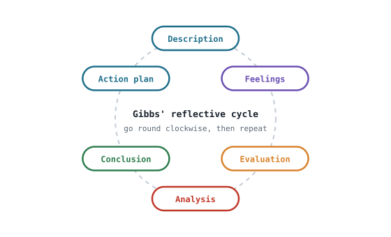

## The idea
**Continuing professional development (CPD)** is how engineers keep getting better after their degree, and registration expects you to record it. It's a **cycle**: work out what you need → learn it however suits you → reflect on what you learned → set the next goal. The skill underneath it is **reflection**: looking back at an experience honestly enough to change what you do next time.

## Where CPD comes from
| Academic | Practical | Professional | Volunteering |
|---|---|---|---|
| Lectures, coursework, software, reports | Projects, competitions, prototypes, internships | Talks, industry visits, institution events, societies | Mentoring, outreach, running a club |

The UK-SPEC CPD code asks engineers to **own** their development, do a **variety** of activities, and **record, reflect, evaluate and review**. They should also support other people's development.

## Gibbs' reflective cycle

| Stage | Ask |
|---|---|
| **Description** | What happened? |
| **Feelings** | What did you, and others, feel? |
| **Evaluation** | What went well and badly? |
| **Analysis** | **Why** did it happen that way? |
| **Conclusion** | What did you learn? What do you need to develop? |
| **Action plan** | What will you do next time, and what help do you need? |

The analysis is where most reflections are weak. "The meeting went badly" is a description; "there was no agenda, nobody led, and I didn't speak up when I could have" is analysis.

## SMART goals
| | Ask |
|---|---|
| **S**pecific | What exactly, and what are the steps? |
| **M**easurable | How will I know I've done it? |
| **A**ttainable | Is it realistic for me now? |
| **R**elevant | Does it link to a real gap or next step? |
| **T**ime-bound | By when? |

**Broad:** "contribute more confidently in meetings."
**SMART:** "In each of the next two seminars, bring one prepared question or suggestion, ask a peer afterwards whether it was clear, and record one improvement."

## Evidencing development
A good CPD record links **goal → activity and evidence → what I learned → review and next action**. Evidence is anything dated and checkable: finished work, feedback, a certificate, a before-and-after comparison.

## Check yourself
> [!question]- 1. Make this SMART: "get better at CAD".
> One option: "Complete the Onshape fundamentals course and model three parts from the lab rig by the end of term, checking dimensions against the drawings."
