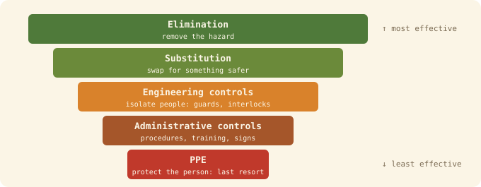

## The idea
The cheapest, strongest safety is designed in at the start: our ability to influence safety is greatest at the concept stage and falls as a project goes on (Szymberski, 1997). Operators, maintainers and the public inherit our design choices. **A hazard designed out can't hurt anyone.**

## Why it's a requirement, not an extra
- **The law:** the Health and Safety at Work etc. Act 1974 (s.6) requires designers and manufacturers to make things safe so far as is reasonably practicable. Robots are machinery under the Supply of Machinery (Safety) Regulations 2008.
- **The profession:** the Statement of Ethical Principles puts others' safety first.
- **The standards:** ISO 12100 (general machinery), ISO 10218 (industrial robots), ISO 13482 (personal care and service robots), ISO 13849 and IEC 61508 (safety control systems).

**Write safety as testable requirements:** "The robot shall stop within 1.0 m when a person is detected ahead at 1.5 m/s", not "the robot shall stop quickly". Avoid words like *adequate*, *robust* and *sufficient*.

**ALARP:** risk must be reduced **as low as reasonably practicable**: keep reducing it unless the cost is grossly disproportionate to the benefit. Some risks are intolerable whatever the benefit.

## The hierarchy of controls

The top levels don't rely on people behaving correctly, which is why they're more effective. Usually you combine several.

**Inherent safety: design it out first** (Kletz):
| Principle | Meaning | Delivery robot example |
|---|---|---|
| Minimise | Use less of the hazardous thing | Smaller battery, lower speed and payload |
| Substitute | Use something less hazardous | Safer cell chemistry, soft outer shell |
| Moderate | Use it in a less hazardous form | Speed and force limits in crowds |
| Simplify | Remove complexity that invites error | One obvious stop control, no hidden overrides |

## Reliability isn't safety
A part can be perfectly **reliable** (it does what it was specified to do) and the system still be **unsafe**, because accidents come from interactions and bad requirements. Safety is a property of the **whole system** in its real environment (Leveson, 2012).

## Designing for safe failure
Assume failure will happen, then make sure it fails safely:
1. **Define the safe state** first (stopped, brakes on, lights on)
2. **Fail-safe by default:** power loss leads to the safe state (brakes that apply when unpowered)
3. **Redundancy:** duplicate critical parts
4. **Diversity:** different technologies (lidar, camera, bumper), so one cause can't defeat them all
5. **Graceful degradation:** slow down, *then* stop
6. **Monitoring:** self-tests, watchdog timers, heartbeats

**Barriers:** prefer **passive** (physical, works without power) over **active** (detects and acts) over **procedural** (relies on a person). Prevention beats mitigation, and the barrier closest to the hazard is best.

## The Swiss cheese model (Reason)
Defences are layered like slices of cheese, and every slice has holes. Harm happens when the holes **line up**.
- **Active failures:** at the sharp end, with an immediate effect (a slip, a failed sensor).
- **Latent conditions:** decisions that lie dormant (time pressure, unreliable alarms, untested software updates).

Don't just blame the last person to act: look for the latent conditions.

## Two analysis tools
**HAZOP** (top-down, team workshop, IEC 61882): apply guide words (no, more, less, reverse, other than…) to parameters (speed, direction, power, data, time).

| Parameter | Guide word | Deviation | Safeguard |
|---|---|---|---|
| Speed | MORE | Faster than the limit | Independent hardware speed limiter |
| Detection | NO | Person not detected | Self-test, backup sensors, stop on sensor loss |

**FMEA** (bottom-up, by component, IEC 60812): for each part, the failure mode, effect, and scores for severity (S), occurrence (O) and detection (D), 1–10 each. **RPN = S × O × D**; fix the highest first, and any high severity regardless.

## Safe systems of work
A written procedure for doing a task safely:
1. **Identify** the task and hazards, step by step
2. **Assess** the risk
3. **Choose controls** down the hierarchy, and define the safe state
4. **Write it down:** a method statement, and a **permit to work** for high-risk jobs
5. **Train, equip and supervise**
6. **Monitor and review** after incidents, near misses and changes

**Lock-out/tag-out (LOTO):** before anyone works inside a machine, isolate its energy sources, lock them off, tag them, and prove it's dead.

## Check yourself
> [!question]- 1. Is a warning sign a passive, active or procedural barrier?
> Procedural: it relies on a person reading it and acting. The least reliable kind.

> [!question]- 2. Name one latent condition behind the Uber 2018 crash.
> Emergency braking had been disabled in the design, leaving a distracted safety driver as the only barrier.
