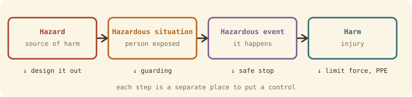
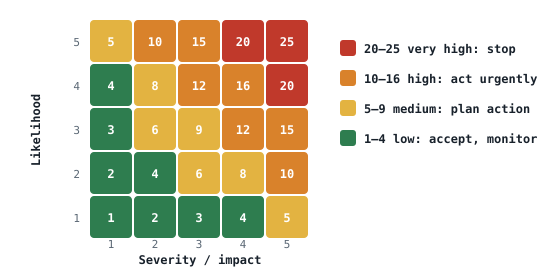

## The idea
A robot combines moving parts, stored energy, software and people. Safety means designing the whole system so that **foreseeable failures and interactions don't cause unacceptable harm**. The tools are a precise vocabulary (ISO 12100), a way to score risk, and a register to track it.

## From hazard to harm

| Step | Meaning | Robot cell example |
|---|---|---|
| **Hazard** | A potential source of harm | A robot arm that can move fast |
| **Hazardous situation** | Someone is exposed to it | A technician enters the cell to clear a jam |
| **Hazardous event** | The thing that causes harm | The arm moves unexpectedly |
| **Harm** | Injury or damage to health | A crush injury |

A hazard exists **whether or not anyone is near it**. Keep the four steps separate, because each one is a different place to put a control.

## Risk
$$\text{Risk} = \text{likelihood} \times \text{severity}$$
ISO 12100 splits likelihood into three parts: **exposure** (how often and how long someone is near), **probability of the event**, and **possibility of avoiding** the harm. Reduce any of them and the risk falls.

**Same hazard, different risk:** a fast robot arm is severity 5 either way. With the operator outside a locked fence, likelihood 1 → risk 5 (low). With a technician teaching it inside the cell at full speed, likelihood 4 → risk 20 (very high). **Controls change the risk, not the hazard.**

Score impact on safety, operations and cost separately, and take the highest. Matrices give **rankings, not measurements**: 1 × 5 and 5 × 1 both score 5 but need very different responses. They support judgement; they don't replace it.

## Where hazards come from
ISO 12100 lists mechanical, electrical, thermal, noise, vibration, radiation, substances, ergonomic and environmental hazards. **Robotics adds software and control** (unexpected restarts, sensor false negatives) **and human–robot interaction** (shared spaces, bypassed interlocks, cyber attacks).

Look across the **whole life**: installation, **teaching**, operation, **maintenance** and disposal. Most accidents happen in the non-routine stages, when guards are open and people are inside. Also consider **reasonably foreseeable misuse**, like reaching past a guard to save time.

## Finding risks
Write every risk as **cause → event → consequence**.

| Technique | How it works |
|---|---|
| Checklists, incident data | Compare with known hazards and past accidents |
| What-if / brainstorming | "What if the light curtain fails?" |
| **HAZOP** | Guide words (no, more, less, reverse…) applied to each function |
| **FMEA** (bottom-up) | Each component: failure mode → effect → cause |
| **Fault tree** (top-down) | From the accident down to causes, through AND/OR gates |
| **STPA** | Unsafe control actions in a whole system |

## The process
Determine the limits → identify hazards → estimate risk → evaluate (acceptable?) → reduce → **loop back** and check for new hazards. It's a cycle, kept alive in a **risk register** with an owner for each risk, reviewed after incidents, changes and near misses.

**Register columns:** ID · description · cause · likelihood · impact · score · action · control level · residual risk

## Controls
Always start at the top of the **hierarchy of controls**, whatever the score (see [[Designing for safety]]). The score sets how **urgently** you act, not which controls you're allowed to skip. Controls usually reduce **likelihood**; severity only drops if the **design** changes (e.g. limiting a cobot's force).

## When it went wrong
| Case | The failure |
|---|---|
| Ford Flat Rock, 1979 | First recorded robot death: no warning or safeguard |
| Kawasaki, 1981 | Interlock bypassed during maintenance, robot still powered |
| Therac-25, 1985–87 | Hardware interlocks replaced by buggy software |
| Uber, Arizona, 2018 | Pedestrian not classified, emergency braking disabled, safety driver distracted |
| Ocado warehouse, 2021 | Robots collided, causing a battery fire |

## Check yourself
> [!question]- 1. "The hazard is the technician being crushed." What's wrong with that?
> It merges all four steps. The hazard is the moving arm; the situation is the technician in the cell; the event is unexpected movement; the harm is the crush injury.

> [!question]- 2. A risk scores 3 × 3 = 9 (medium). Can you go straight to training as the control?
> No. Start at the top of the hierarchy (can it be eliminated or engineered out?). The score sets urgency, not which controls to consider.
