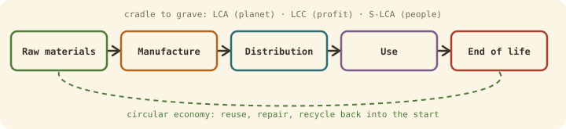

## The idea
> "Development that meets the needs of the present without compromising the ability of future generations to meet their own needs." (Brundtland report, 1987)

Every engineered thing sits between people and the environment, so every project either helps sustainability or doesn't. **Lifecycle thinking** means looking past the factory to the whole life of a product: where its materials come from, what it costs to run, and what happens when it's thrown away.

## The triple bottom line
A sustainable solution balances all three pillars, not just one:

| Pillar | Also called | Covers |
|---|---|---|
| Environmental | **Planet** | Resources, emissions, pollution, biodiversity |
| Social | **People** | Communities, wellbeing, fairness, safety |
| Economic | **Profit** | Viability, lifecycle cost, long-term value |

The UN's 17 **Sustainable Development Goals** (2015, target 2030) are the global version.

## The Engineering Council's six principles
1. Contribute to a sustainable society, present and future
2. Lead with professional and responsible judgement
3. **Go beyond compliance**: meeting the law isn't enough
4. Use resources efficiently across the whole lifecycle
5. Seek multiple views, including affected communities
6. Manage risk to minimise harm and maximise benefit

## Lifecycle thinking

| Pillar | Tool | What it measures |
|---|---|---|
| Planet | **LCA**, life cycle assessment (ISO 14040/44) | Environmental impact, cradle to grave |
| Profit | **LCC**, life cycle costing | Every cost: purchase, running, repair, disposal |
| People | **S-LCA**, social LCA | Impacts on workers and communities |

LCA + LCC + S-LCA together make an **LCSA** (life cycle sustainability assessment). Partial versions focus on one thing, like a **carbon footprint** (ISO 14067).

## Key ideas
- **Systems thinking:** fix root causes and avoid **burden shifting** (solving one problem by creating another somewhere else).
- **Circular economy:** replace "make, use, dispose" with a loop of reuse, repair and recycling.
- **Industrial symbiosis:** one plant's waste becomes another's resource (e.g. Kalundborg, Denmark, sharing steam, water and by-products).

## Applied to a delivery robot
| Stage | Questions to ask |
|---|---|
| Raw materials | Where do the lithium cells and rare-earth motor magnets come from, and under what conditions? |
| Manufacture | Energy used, prototyping waste |
| Distribution | Packaging and transport |
| Use | Electricity, including the compute for its AI model |
| End of life | Battery disposal, e-waste, what can be reused |

## Check yourself
> [!question]- 1. A robot's new motor is 5% more efficient but uses a rare-earth magnet with a damaging supply chain. Which tools would show the trade-off?
> LCA (environmental impact of mining vs energy saved in use) and S-LCA (supply-chain working conditions), with LCC for the cost side.
