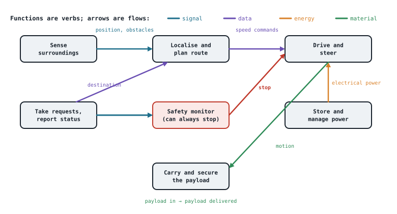

## The idea
When you move into a new house, which change would be the most expensive and disruptive: repainting a room, changing the door handles, or moving a load-bearing wall? The wall, because everything else depends on it. The paint and handles are **design**; the wall is **architecture**.

**Architecture is the few structural choices that shape everything else and are hard to undo.** Design works inside it.

| Architecture is used to… | Design is used to… |
|---|---|
| Discover and refine the requirements | Develop the individual components |
| Steer the system towards its purpose | Build and integrate them |
| Choose between options | Work *within* the architecture |
| Decide what to make and what to buy | Track configuration changes |

For a delivery robot: wheeled or legged, how it gets between floors, and having an independent safety layer are **architecture**. Which lidar model, or the wheel diameter, is **design**.

> "The fundamental concepts or properties of a system in its environment embodied in its elements, relationships, and in the principles of its design and evolution." (ISO/IEC/IEEE 42010)

| Part | Delivery robot example |
|---|---|
| **Elements** | Mobility, perception, navigation, planning, fleet service |
| **Relationships** (what flows between them) | Perception feeds navigation; navigation commands mobility |
| **Principles** | The safety layer can always override the planner; sensors are swappable modules |

**The same parts in a different structure behave differently.** A roundabout and a set of traffic lights use the same cars and drivers but produce different traffic. In robots, centralised and layered control fail in different ways.

## Decide early, while it's cheap
- **Most is decided when least is known:** the architecture is chosen at the concept stage, before anything has been tested.
- **Late changes cost the most:** a change after build touches hardware, software *and* the safety evidence.
- So **explore alternatives early**, while comparing them only costs paper.

## Views: one system, several pictures
| View | For | Shows | Example |
|---|---|---|---|
| **Operational** | Users and operators | Scenarios and task flows | A day in the life: dock → collect → deliver → dock |
| **Logical** | Customers and managers | Boundary, functions, data flows, interfaces | Context diagram, functional flow diagram |
| **Physical** | Designers | Parts, connections, standards | Block diagram of sensors, computer, motors and battery |

Every view exists to **communicate** something to someone. Draw the views the conversation needs, not all of them.

## Decomposition
Decomposition means **breaking a system into parts that can be designed, built, bought and tested, with defined interfaces between them**. A bicycle breaks into frame, wheels, drivetrain (pedals, crank, chain, gears, hub), brakes and steering.

**Where do you stop?** When each part can have an **owner, a requirement and a test** (Kossiakoff et al., 2020).

**A good decomposition is** (Maier and Rechtin, 2009):
- **Cohesive:** each part has one clear job
- **Loosely coupled:** few, simple interfaces between parts
- **Owned:** a team or supplier can be responsible for it
- **Testable:** each part can be checked on its own

A standard plug and socket is the model of a good interface: any appliance, any maker, any room.

**Building blocks**, by what each one handles:
| Block | Does | Robot example |
|---|---|---|
| **Signal** | Senses and communicates information | Lidar, camera, radio |
| **Data** | Interprets, organises, manipulates information | Computer, navigation software, map |
| **Material** | Gives structure or transforms material | Chassis, wheels, payload bay |
| **Energy** | Supplies energy and motion | Battery, motors, charger |

## Functional, physical and allocated architecture
1. **Functional architecture: verbs.** What must the system *do*? (Sense surroundings, plan a route, drive…)
2. **Physical architecture: nouns.** What is it *made of*? (Lidar, computer, motors…)
3. **Allocated architecture:** which part performs which function.

**Trace it: requirement → function → part.** Then, when one changes, you can see what else is affected. A requirement like "the robot shall stop within 1 m of a detected person" traces to the *safety monitor* function, which traces to the sensors, the computer and the brakes.

**Auditing an allocation** shows where the risks are:
| Pattern | What it means |
|---|---|
| A function with **no part** | A **gap** in capability |
| A function on **one part only** | A **single point of failure** |
| A function on **several parts** | Planned **redundancy**, or accidental overlap? |
| A part with **no function** | Why is it there? |

*Example audit:* "detect a step or stair edge" with no part allocated is a gap, and a safety one. "Detect obstacles" allocated to both lidar and a bumper is deliberate redundancy, which is good for safety. "Plan a route" on software alone is a single point of failure, so it needs a safe fallback.

Functions that need several parts working together are often the hardest to get right. "Return to the dock" needs sensing, localisation, planning, driving and battery monitoring all at once.

## The system lifecycle
> "The stepwise evolution of a new system from concept through development and on to production, operation, and ultimate disposal." (Kossiakoff et al., 2020)

There's no single standard model (ISO 15288 uses six stages, the US DoD five phases), but they all split a system's life into steps separated by decisions. Kossiakoff et al. use **three stages and eight phases**:

| Stage | Phases | What happens |
|---|---|---|
| **1. Concept development** | Needs analysis → concept exploration → concept definition | Establish the need, explore options, **choose the architecture** |
| **2. Engineering development** | Advanced development → engineering design → integration and evaluation | Define the interfaces, design in detail, test the whole |
| **3. Post-development** | Production → operations and support | Build, deploy, use, maintain, upgrade, then retire |

**Each phase defines the next level down:** system capabilities → subsystem requirements and architecture → component specifications → detailed design → parts made or bought. Even at the concept stage you have to picture the physical form roughly, or you can't judge cost and feasibility.

**Lifecycle thinking also means the whole life.** For a washing machine that lasts ten years, most of its environmental impact comes from the **use** stage (energy and water every wash), not manufacture. Designing for the whole life (maintenance, upgrades, disposal) is part of the architecture too (see [[Sustainability and lifecycle thinking]]).

## Check yourself
> [!question]- 1. Architecture or design? (a) choosing a 1.8° stepper over a 0.9° one (b) deciding the robot has an independent safety controller (c) choosing four wheels instead of tracks
> (a) **design** · (b) **architecture** (a structural principle that's hard to undo) · (c) **architecture** (it shapes the chassis, drive, control and where the robot can go)

> [!question]- 2. Write three functions of a delivery robot as verbs, and tag each as signal, data, energy or material.
> For example: *detect obstacles* (signal) · *plan a route* (data) · *carry the payload* (material) · *drive the wheels* (energy).

> [!question]- 3. Why is an architectural mistake found during testing so expensive?
> Fixing it means changing the structure everything else was built on: hardware, software, interfaces and the safety evidence all have to be redone, whereas at the concept stage it would only have meant changing a diagram.

Back to [[WM199/index|WM199]], or see [[Systems thinking]].
