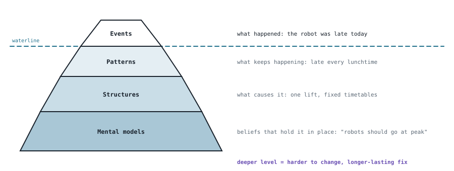
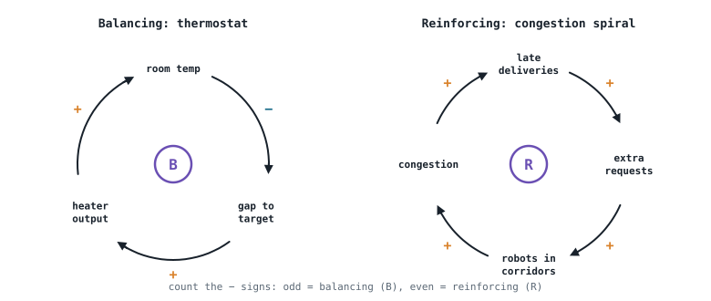

## The idea
Widen a jammed three-lane motorway to four lanes and, a few years later, rush hour is about as bad as before. The new capacity changes behaviour: more people choose to drive, and the extra traffic fills the road. In US cities, traffic grew roughly in proportion to the road that was built (Duranton and Turner, 2011).

The lesson isn't "never build roads". It's that **a system pushes back**, so you have to plan for how it will respond. Engineers meet this all the time:
- **Failures happen between the parts.** The delivery robot works and the lift works, but the robot–lift interface doesn't, and no single team owns that failure.
- **Optimising the parts doesn't optimise the whole.** The best lidar, planner and battery don't guarantee the best delivery service.
- **Fixing one part can move the problem.** A faster robot shortens deliveries but lengthens its stopping distance.

Systems thinking is one of the Royal Academy of Engineering's six engineering habits of mind.

| Analytical thinking | Systems thinking |
|---|---|
| Break the problem into parts; study and optimise each | Look at the whole, its purpose and its context |
| Assumes the whole is the sum of its parts | Focuses on relationships, feedback and delays |
| | Expects behaviour no single part has (**emergence**) |
| Good for component design, calculation, testing | Good for requirements, safety, architecture, decisions |

You need both: analysis to understand the parts, systems thinking to understand what they do together.

## The iceberg model
Only the top of a problem is visible. The deeper you go, the more lasting the fix:

Fixing an *event* (sending the robot again) helps once. Changing a *structure* (scheduling deliveries outside the lunchtime rush) or a *mental model* (what the service is for) stops it recurring.

## What is a system?
> "A combination of interacting elements organised to achieve one or more stated purposes." (ISO/IEC/IEEE 15288)
> "An interconnected set of elements coherently organised in a way that achieves something." (Meadows, 2008)

| Part | Meaning | Delivery robot service |
|---|---|---|
| **Elements** | The parts | Robots, fleet software, charging docks, lifts, staff |
| **Interconnections** | How they affect each other | Requests, routes, lift calls, battery charge |
| **Purpose** | Why it exists | Moving equipment between labs safely and on time |
| **Boundary** | What's in and what's out | Which you choose depends on the question you're asking |

**Is it a system?** Check for elements, interactions *and* a purpose. A bicycle is (parts interact to give transport). A bag of marbles isn't (elements, but no interconnections). A traffic jam is a system with *emergent* behaviour: the interactions are real, but nobody designed its purpose.

**Changing a system.** Swapping an element (a new sensor model) has the smallest effect. Changing the interconnections (how the safety layer can override the planner) has more. Changing the purpose (from delivery to inspection) changes everything.

## Stocks and flows
A **stock** is anything that accumulates, and it can only change through its **flows**, at the rate they allow. A bath is the picture to keep in mind: the water level (stock) changes only through the tap (inflow) and the drain (outflow).

| Stock | Inflow | Outflow |
|---|---|---|
| Robot battery charge | Charging at the dock | Driving and sensing |
| Delivery queue | New requests | Completed deliveries |
| Bank balance | Income | Spending |

This explains delays: even if you open the tap fully, the level takes time to rise.

## Boundaries, subsystems and systems of systems
**Where you draw the boundary matters.** For the delivery robot you might draw it round the robot alone, the whole service (fleet software, docks, staff), the campus (lifts, doors, people, Wi-Fi), or the wider context (regulation, weather, university policy).
- **Too narrow,** and the system surprises you: the robot passes every test but fails at the lift.
- **Too wide,** and nothing can be designed or tested.
- **Nothing goes "away":** a discarded battery still exists somewhere, which is why lifecycle thinking matters (see [[Sustainability and lifecycle thinking]]).

**Every system is a subsystem of something larger.** Zoom in: a phone → its camera (subsystem) → the image sensor module (component) → the lens stack → a single lens (part). Zoom out: the phone → the mobile network → the digital economy.

**A system of systems is one where nobody owns the whole.** Maier's (1998) five characteristics:
1. **Operational independence:** each part works on its own
2. **Managerial independence:** each part is owned and run separately
3. **Geographic distribution:** spread out, connected by information
4. **Emergent behaviour:** the whole does things no part does
5. **Evolutionary development:** parts change on their own schedules

Air travel is the classic example (airlines, airports, air traffic control, suppliers). You can design your own system but not the others, so you have to **agree interfaces and assumptions with their owners**. The delivery robot relies on the university's lifts, doors and Wi-Fi in exactly this way.

## How systems interact
Systems exchange four kinds of **flow** across their interfaces. A phone charger shows all four:

| Flow | Phone charger |
|---|---|
| Material | The plug goes into the socket |
| Energy | Mains power into the battery |
| Information | Phone and charger agree the charging rate |
| Force | The plug is pushed and held in place |

| Interface element | What it does | Examples |
|---|---|---|
| **Connector** | Enables an interaction | USB-C cable, message bus, handover tray |
| **Isolator** | Prevents one | Phone case, rubber mount, firewall |
| **Converter** | Changes its form | Plug adapter, charger, loudspeaker |

## Feedback loops
Draw arrows from cause to effect, marking **+** if both move the same way and **−** if they move opposite ways. **Count the minus signs: odd means balancing, even means reinforcing.**

- **Balancing (B)** loops seek a goal and resist change. A thermostat is the standard example: it works to close the gap between the room temperature and the setting.
- **Reinforcing (R)** loops amplify change, for better or worse. Late deliveries lead to more chasing requests, more robots in the corridors, more congestion, and more late deliveries.
- **Delays** between an action and its effect can turn a balancing loop into an **oscillating** one, like an over-correcting shower temperature (Meadows, 2008).

## Complicated vs complex
| Complicated | Complex |
|---|---|
| Many parts, but cause and effect can be worked out | Parts adapt and interact, so behaviour emerges and surprises |
| A watch, a jet engine, a gearbox | Rush-hour traffic, an ecosystem, a crowd |
| Analyse, specify, test | Add margins, monitor, experiment and learn |

A robot is **complicated inside, and becomes complex the moment it meets people**. Perrow (1984) argued that tightly coupled, interactive systems will have accidents that design has to anticipate.

## Why systems surprise us (Meadows, 2008)
- **Limits:** the scarcest input sets the pace. More robots don't help if the lift or the dock is the bottleneck.
- **Delays:** effects arrive later than expected.
- **Bounded rationality:** everyone sees only their part. Each person leaving a lecture at ten to the hour is acting sensibly; the corridor jam is nobody's decision.

## Leverage points: where to intervene
Meadows (2008) ranked places to intervene in a system. The higher ones are harder to change but far more powerful. For traffic congestion:

| Leverage point | Example |
|---|---|
| **Goals and mindset** (most powerful) | Move people and goods, not cars |
| **Rules** | A congestion charge |
| **Information flows** | Live journey times before people choose a route |
| **Loops and delays** | Real-time route advice |
| **Buffers and structure** | Spare capacity on rail |
| **Numbers** (least powerful) | Add a lane |

Most debate happens at the bottom of the table, while most of the power sits at the top.

## Why it matters
- **Requirements and safety** come from the whole system, not just the robot: many hazards sit **at interfaces** (a robot meeting a person at a doorway) or come from **behaviour** (people reaching into machines), as in [[Hazards and risk assessment]].
- **Architecture** starts with the boundary, the subsystems and the interfaces between them: see [[System architecture and lifecycle]].

## Check yourself
> [!question]- 1. Is a pile of bicycle parts on a bench a system? What about the assembled bicycle?
> The pile isn't: it has elements but no interconnections or purpose. The assembled bicycle is: its parts interact to provide transport.

> [!question]- 2. Classify the loop: low battery → robot returns to dock → charge rises → (less need to) return.
> Battery charge → need to return is **−**, return → charge is **+**. One minus sign, so it's **balancing**: it keeps the charge in a working range.

> [!question]- 3. Adding three more delivery robots made deliveries slower. Give a systems explanation.
> The bottleneck was elsewhere (one lift, or one dock), so more robots just meant more queuing and congestion: a **limit**, possibly with a reinforcing congestion loop. The fix is at a higher leverage point, such as scheduling or rules about lift use.

Next: [[System architecture and lifecycle]].
