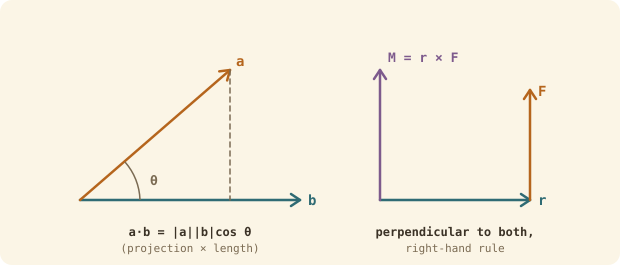

## The idea
A **vector** has a size *and* a direction: position, velocity, force. Mechanics is full of them, and two ways of multiplying them do most of the work: the **dot product** (how much of one points along the other) and the **cross product** (turning effect, like a moment).

## Writing vectors
- **Components:** $\mathbf v = a\mathbf i + b\mathbf j + c\mathbf k$, where $\mathbf i, \mathbf j, \mathbf k$ are unit vectors along x, y, z.
- **Magnitude:** $|\mathbf v| = \sqrt{a^2 + b^2 + c^2}$
- **Direction (2D):** $\theta = \tan^{-1}(b/a)$. Check the quadrant.
- **Unit vector:** $\hat{\mathbf v} = \mathbf v / |\mathbf v|$, length 1.
- Add, subtract and scale component by component.

## Dot product (gives a number)
$$\mathbf a \cdot \mathbf b = a_xb_x + a_yb_y + a_zb_z = |\mathbf a||\mathbf b|\cos\theta$$
- Use it to find the **angle** between two vectors.
- **Perpendicular** vectors have $\mathbf a \cdot \mathbf b = 0$.
- The **component of a along b** is $\mathbf a \cdot \hat{\mathbf b}$. That's how you resolve a force along a direction.

## Cross product (gives a vector)
$$\mathbf a \times \mathbf b = \begin{vmatrix} \mathbf i & \mathbf j & \mathbf k \\ a_x & a_y & a_z \\ b_x & b_y & b_z \end{vmatrix} \qquad |\mathbf a \times \mathbf b| = |\mathbf a||\mathbf b|\sin\theta$$
- The result is **perpendicular to both**, with direction from the right-hand rule.
- **Order matters:** $\mathbf a \times \mathbf b = -\,\mathbf b \times \mathbf a$.
- Main use: the **moment of a force**, $\mathbf M = \mathbf r \times \mathbf F$, with $\mathbf r$ first.

## Worked example
$\mathbf a = 2\mathbf i + 3\mathbf j - \mathbf k$, $\mathbf b = \mathbf i - \mathbf j + 4\mathbf k$. Find $\mathbf a \cdot \mathbf b$, the angle between them, and $\mathbf a \times \mathbf b$.

> [!example]- Answer
> $\mathbf a \cdot \mathbf b = 2 - 3 - 4 = -5$. $|\mathbf a| = \sqrt{14}$, $|\mathbf b| = \sqrt{18}$.
> $\cos\theta = \dfrac{-5}{\sqrt{14}\sqrt{18}} = -0.315$ → $\theta = 108.4°$
> $\mathbf a \times \mathbf b = (3\cdot4 - (-1)(-1))\mathbf i - (2\cdot4 - (-1)\cdot1)\mathbf j + (2(-1) - 3\cdot1)\mathbf k = 11\mathbf i - 9\mathbf j - 5\mathbf k$
> Check it's perpendicular to $\mathbf a$: $22 - 27 + 5 = 0$ ✓

## Common mistakes
- Forgetting the minus sign on the $\mathbf j$ term of the cross product.
- Swapping the order in $\mathbf r \times \mathbf F$, which flips the moment's direction.
- Using degrees mode when the question is in radians, or the other way round.

## Check yourself
> [!question]- 1. A 50 N force acts in the +y direction at a point 0.3 m along x from a pivot. Moment?
> $\mathbf M = 0.3\mathbf i \times 50\mathbf j = 15\mathbf k$ N m: 15 N m anticlockwise about z.

> [!question]- 2. Are $3\mathbf i + 4\mathbf j$ and $-4\mathbf i + 3\mathbf j$ perpendicular?
> Yes: $-12 + 12 = 0$.
