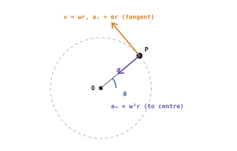

## The idea
On a curved path, velocity and acceleration become **vectors**. The velocity always points along the path (tangent to it). The acceleration generally doesn't, because it's doing two jobs: changing the **speed** and changing the **direction**.

## Position, velocity and acceleration as vectors
In x–y components:
$$\mathbf r = x\mathbf i + y\mathbf j \qquad \mathbf v = \dot x\mathbf i + \dot y\mathbf j \qquad \mathbf a = \ddot x\mathbf i + \ddot y\mathbf j$$
Magnitudes come from Pythagoras, e.g. $v = \sqrt{\dot x^2 + \dot y^2}$.

**Averages:** $\mathbf v_{avg} = \Delta\mathbf r / \Delta t$ uses the straight-line displacement, not the distance along the curve.

## Circular motion
For a point moving round a circle of radius $r$ (angle $\theta$ in **radians**):

$$s = r\theta \qquad v = r\omega \qquad a_t = r\alpha \qquad a_n = \frac{v^2}{r} = \omega^2 r \qquad a = \sqrt{a_t^2 + a_n^2}$$

- **Tangential** $a_t$ changes the **speed**.
- **Normal** $a_n$, pointing to the centre, changes the **direction**. Even at constant speed, $a_n \neq 0$.
- Angular versions of the constant-acceleration equations:
$$\omega = \omega_0 + \alpha t \qquad \theta = \theta_0 + \omega_0t + \tfrac12\alpha t^2 \qquad \omega^2 = \omega_0^2 + 2\alpha(\theta - \theta_0)$$

**Conversions:** 1 rev = $2\pi$ rad · rpm × $\dfrac{2\pi}{60}$ = rad/s

## Worked examples
**1.** A particle's position is $\mathbf r = 2t^2\mathbf i + 3t\mathbf j$ m. Find its speed and acceleration at $t = 2$ s.

> [!example]- Answer
> $\mathbf v = 4t\mathbf i + 3\mathbf j = 8\mathbf i + 3\mathbf j$ → $v = \sqrt{64 + 9} = 8.54$ m/s
> $\mathbf a = 4\mathbf i$ → $a = 4$ m/s², pointing along x

**2.** A robot wheel of radius 0.25 m spins at 12 rad/s and is speeding up at 5 rad/s². Find the speed and acceleration of a point on its rim.

> [!example]- Answer
> $v = 0.25 \times 12 = 3$ m/s
> $a_t = 0.25 \times 5 = 1.25$ m/s², $a_n = 12^2 \times 0.25 = 36$ m/s²
> $a = \sqrt{1.25^2 + 36^2} = 36.0$ m/s². The normal part dominates.

## Common mistakes
- Using degrees in $s = r\theta$ or $v = r\omega$. They only work in radians.
- Forgetting $a_n$ when the speed is constant.
- Using distance instead of displacement for average velocity.

## Check yourself
> [!question]- 1. A point at 0.1 m from an axle turning at 600 rpm. Speed and normal acceleration?
> $\omega = 600 \times 2\pi/60 = 62.8$ rad/s, $v = 6.28$ m/s, $a_n = 62.8^2 \times 0.1 = 395$ m/s².
