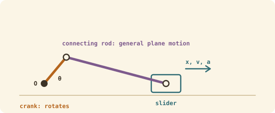

## The idea
Once a body's size and shape matter (gears, cranks, linkages), it can't be treated as a single point. In flat (planar) mechanisms, a rigid body can only move in three ways.

| Type | What happens | In a slider-crank |
|---|---|---|
| **Translation** | Every line on the body stays parallel to itself. Straight paths (rectilinear) or curved ones (curvilinear) | The slider (piston) |
| **Rotation about a fixed axis** | Every point moves in a circle round the axis | The crank |
| **General plane motion** | Translation and rotation at once | The connecting rod |

## Translation
Every point has the **same** velocity and acceleration. Treat the whole body as a particle.

## Rotation about a fixed axis
$$\omega = \frac{d\theta}{dt}\ \text{(rad/s)} \qquad \alpha = \frac{d\omega}{dt} = \frac{d^2\theta}{dt^2}\ \text{(rad/s}^2\text{)}$$
A point at radius $r$: $v = \omega r$, $a_t = \alpha r$, $a_n = \omega^2r$ (see [[Curvilinear and circular motion]]).

- **Constant α:** use the angular constant-acceleration equations.
- **α varies with time:** integrate, $\int d\omega = \int\alpha\,dt$, then $\int d\theta = \int\omega\,dt$.
- **α depends on angle:** use $\omega\,d\omega = \alpha\,d\theta$.

A **smooth pin** support stops a body moving sideways or up and down, but lets it rotate freely.

## Worked examples
**1.** A motor spins up uniformly from rest to 3000 rpm in 2 s. Find α and how many revolutions it makes.

> [!example]- Answer
> $\omega = 3000 \times 2\pi/60 = 314.2$ rad/s, so $\alpha = 314.2/2 = 157.1$ rad/s²
> $\theta = \tfrac12 \times 157.1 \times 2^2 = 314.2$ rad $= 50$ rev

**2.** A gear starts at 10 rad/s with $\alpha = 6t$ rad/s². Find ω and θ after 2 s.

> [!example]- Answer
> $\omega = 10 + 3t^2 = 22$ rad/s
> $\theta = 10t + t^3 = 28$ rad

## Check yourself
> [!question]- 1. Which type of motion does a lift car have?
> Translation (rectilinear): every point moves the same way.

> [!question]- 2. A flywheel slows from 50 to 20 rad/s in 6 s at a constant rate. α?
> $\alpha = (20 - 50)/6 = -5$ rad/s².
