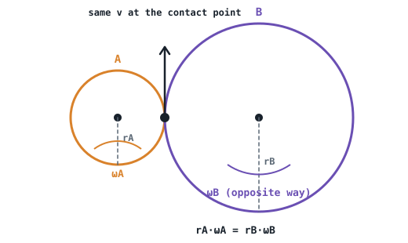

## The idea
Gears, belts and cords pass motion from one body to another. The key is **what's shared at the contact**: where two gears mesh (or a belt grips a pulley without slipping), the touching points move **together**, so they have the same speed along the contact.

## The rules
**Meshing gears, and belts or cords with no slip:**
$$r_A\omega_A = r_B\omega_B \qquad r_A\alpha_A = r_B\alpha_B$$
**Things on the same shaft** share $\omega$ and $\alpha$.

- A small gear driving a big one **slows the output** and (ideally) **multiplies the torque** by the same ratio.
- Meshing gears turn **opposite** ways. A belt keeps the **same** direction (unless it's crossed).
- To go from rotation to a load on a cord or drum: $v = r\omega$, $a = r\alpha$.

## Mechanism vocabulary
- A **link** is a rigid body with at least two attachment points (nodes). Two nodes = binary, three = ternary.
- **Full joints** allow one degree of freedom: a **pin (revolute)** joint allows rotation only; a **slider (prismatic)** joint allows translation only.

## Worked examples
**1.** A motor's 20 mm pinion turns at 1500 rpm and drives an 80 mm gear. Output speed and ideal torque ratio?

> [!example]- Answer
> $\omega_B = 1500 \times \dfrac{20}{80} = 375$ rpm, turning the opposite way.
> The torque is multiplied by $80/20 = 4$ (ignoring losses).

**2.** Gear A (r = 50 mm) starts from rest with $\alpha_A = 3$ rad/s² and drives gear B (r = 150 mm). A 100 mm drum on B's shaft winds up a cable lifting a load. Find the load's acceleration and speed after 4 s.

> [!example]- Answer
> Mesh: $\alpha_B = \dfrac{50 \times 3}{150} = 1$ rad/s². The drum shares B's shaft, so $\alpha_D = 1$ rad/s².
> $a_{load} = r_D\alpha_D = 0.1 \times 1 = 0.1$ m/s²
> $v = 0 + 0.1 \times 4 = 0.4$ m/s

## The pattern for any drive problem
1. Find what's shared at each contact: the same **tangential** $v$ and $a$.
2. Convert between linear and angular with $r$ at each step.
3. Use the constant-α equations if α is constant.

## Common mistakes
- Using diameters on one side and radii on the other. Either works, but be consistent.
- Assuming meshing gears have the same ω. They have the same **rim speed**.
- Forgetting gears on a shared shaft have the same ω even if their radii differ.

## Check yourself
> [!question]- 1. A 0.15 m pulley at 7.1 rad/s drives a 0.4 m pulley by belt. Speed of the second pulley's rim?
> Same as the first: $0.15 \times 7.1 = 1.07$ m/s. Its ω is $1.07/0.4 = 2.66$ rad/s.
