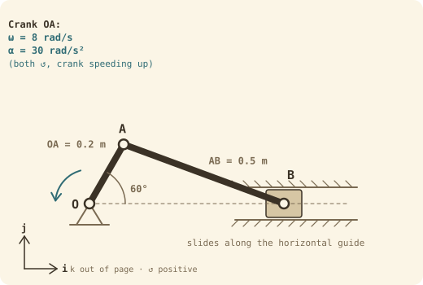

## Why this one
One question that uses every Week 1–3 skill: geometry with Pythagoras, position vectors, cross products, relative velocity, relative acceleration (tangential **and** normal parts), a sliding constraint, and reading the signs of the answers. It's the same kind of mechanism as the A2 rig, and it's set up like a test question. Try each part before opening the answer.

Theory: [[Relative motion analysis]] · [[Absolute motion analysis]] · [[Rigid body rotation]]

## The question
A slider-crank has crank **OA = 0.2 m** pinned at O and connecting rod **AB = 0.5 m**. Slider B moves along a horizontal guide level with O. At the instant shown, the crank is at **60°** above the horizontal and is turning **anticlockwise** at **ω = 8 rad/s**, and **speeding up** at **α = 30 rad/s²**.

Find:
- **(a)** The position of B, and the position vector $\mathbf r_{B/A}$
- **(b)** The velocity of A
- **(c)** The angular velocity of rod AB and the velocity of slider B
- **(d)** The acceleration of A
- **(e)** The angular acceleration of rod AB and the acceleration of slider B
- **(f)** Is the slider speeding up or slowing down? Describe the motion of each link.

> [!tip] What's different from the lecture example
> Here the crank is **speeding up**, so A has a tangential acceleration as well as a normal one. The slider moves **horizontally**, so the constraint kills the **j** parts instead of the **i** parts. And the answers come out **negative**, so you have to interpret the signs.

## Set-up
Origin at O, **i** right, **j** up, **k** out of the page, anticlockwise positive. Cross products you need (not on the formula sheet):
$$\mathbf k\times\mathbf i = \mathbf j \qquad \mathbf k\times\mathbf j = -\mathbf i \qquad\Rightarrow\qquad \omega\mathbf k\times(x\,\mathbf i + y\,\mathbf j) = -\omega y\,\mathbf i + \omega x\,\mathbf j$$

> [!example]- (a) Geometry
> **A:** $\mathbf r_A = 0.2\cos60°\,\mathbf i + 0.2\sin60°\,\mathbf j = 0.1\,\mathbf i + 0.1732\,\mathbf j$
>
> **B** is on the line through O, so it's 0.1732 m **below** A. Pythagoras on the rod:
> $$\text{horizontal gap} = \sqrt{0.5^2 - 0.1732^2} = \sqrt{0.22} = 0.4690\ \text{m}$$
> So $x_B = 0.1 + 0.4690 = \mathbf{0.569\ m}$ from O, and
> $$\mathbf r_{B/A} = 0.4690\,\mathbf i - 0.1732\,\mathbf j$$
> The rod sits at $\tan^{-1}(0.1732/0.4690) = 20.3°$ below horizontal.

> [!example]- (b) Velocity of A
> $$\mathbf v_A = \boldsymbol\omega_{OA}\times\mathbf r_A = 8\mathbf k\times(0.1\,\mathbf i + 0.1732\,\mathbf j) = -1.386\,\mathbf i + 0.8\,\mathbf j\ \text{m/s}$$
> Size $= 8 \times 0.2 = 1.6$ m/s, perpendicular to OA (up and to the left), as it should be for an anticlockwise crank.

> [!example]- (c) Angular velocity of AB, velocity of B
> $$\mathbf v_B = \mathbf v_A + \boldsymbol\omega_{AB}\times\mathbf r_{B/A}$$
> B can only move along the guide, so $\mathbf v_B = v_B\,\mathbf i$ (**no j part**).
> $$\omega_{AB}\mathbf k\times(0.4690\,\mathbf i - 0.1732\,\mathbf j) = 0.1732\,\omega_{AB}\,\mathbf i + 0.4690\,\omega_{AB}\,\mathbf j$$
> $$v_B\,\mathbf i = (-1.386 + 0.1732\,\omega_{AB})\,\mathbf i + (0.8 + 0.4690\,\omega_{AB})\,\mathbf j$$
> **j** (one unknown, so do it first): $0 = 0.8 + 0.4690\,\omega_{AB}$ → $\omega_{AB} = \mathbf{-1.706\ rad/s}$, i.e. **1.71 rad/s clockwise**
>
> **i**: $v_B = -1.386 + 0.1732(-1.706) = \mathbf{-1.681\ m/s}$, i.e. **1.68 m/s to the left**

> [!example]- (d) Acceleration of A
> The crank is speeding up, so A has **both** parts:
> $$\mathbf a_A = \boldsymbol\alpha_{OA}\times\mathbf r_A - \omega_{OA}^2\,\mathbf r_A$$
> $$= 30\mathbf k\times(0.1\,\mathbf i + 0.1732\,\mathbf j) - 64(0.1\,\mathbf i + 0.1732\,\mathbf j)$$
> $$= (-5.196\,\mathbf i + 3\,\mathbf j) - (6.4\,\mathbf i + 11.085\,\mathbf j) = -11.596\,\mathbf i - 8.085\,\mathbf j\ \text{m/s}^2$$
> Check: tangential $= 30\times0.2 = 6$, normal $= 64\times0.2 = 12.8$, total $=\sqrt{6^2+12.8^2} = 14.1$ m/s², and $\sqrt{11.596^2 + 8.085^2} = 14.1$ ✓

> [!example]- (e) Angular acceleration of AB, acceleration of B
> $$\mathbf a_B = \mathbf a_A + \boldsymbol\alpha_{AB}\times\mathbf r_{B/A} - \omega_{AB}^2\,\mathbf r_{B/A}, \qquad \mathbf a_B = a_B\,\mathbf i$$
> Tangential: $\alpha_{AB}\mathbf k\times(0.4690\,\mathbf i - 0.1732\,\mathbf j) = 0.1732\,\alpha_{AB}\,\mathbf i + 0.4690\,\alpha_{AB}\,\mathbf j$
>
> Normal: $-(1.706)^2(0.4690\,\mathbf i - 0.1732\,\mathbf j) = -2.909(0.4690\,\mathbf i - 0.1732\,\mathbf j) = -1.364\,\mathbf i + 0.504\,\mathbf j$
>
> **j**: $0 = -8.085 + 0.4690\,\alpha_{AB} + 0.504$ → $\alpha_{AB} = \mathbf{16.2\ rad/s^2}$ **anticlockwise**
>
> **i**: $a_B = -11.596 + 0.1732(16.16) - 1.364 = \mathbf{-10.2\ m/s^2}$, i.e. **10.2 m/s² to the left**
>
> Note the square: $\omega_{AB}^2$ is positive even though $\omega_{AB}$ is negative.

> [!example]- (f) Interpreting the answers
> - $v_B$ and $a_B$ are **both negative** (both to the left), so the slider is **speeding up** as it moves left. Same sign means speeding up; opposite signs means slowing down.
> - $\omega_{AB}$ is clockwise but $\alpha_{AB}$ is anticlockwise, so the rod's rotation is **slowing down** at this instant.
> - **Crank OA:** fixed-axis rotation about O (revolute joint). **Rod AB:** general plane motion (translation plus rotation). **Slider B:** rectilinear translation along a prismatic joint. Pins at O, A and B plus a prismatic joint between the slider and its guide make a four-link chain (ground, crank, rod, slider) with **one degree of freedom**: set the crank angle and everything else is fixed.

## Answers
| | Answer |
|---|---|
| $x_B$ | 0.569 m from O |
| $\mathbf v_A$ | $-1.386\,\mathbf i + 0.8\,\mathbf j$ m/s (1.6 m/s) |
| $\omega_{AB}$ | 1.71 rad/s clockwise |
| $v_B$ | 1.68 m/s left |
| $\mathbf a_A$ | $-11.60\,\mathbf i - 8.09\,\mathbf j$ m/s² (14.1 m/s²) |
| $\alpha_{AB}$ | 16.2 rad/s² anticlockwise |
| $a_B$ | 10.2 m/s² left (speeding up) |

## Common mistakes
1. **Forgetting A's tangential acceleration.** It's only zero when the crank turns at a constant rate.
2. **Using the wrong constraint.** A horizontal slider has no **j** velocity or acceleration, so the **j** equation is the one with a single unknown.
3. **Sign of $\omega^2$.** Square the number, including its minus sign: $(-1.706)^2 = +2.909$.
4. **Getting $\mathbf r_{B/A}$ the wrong way round.** It runs from A to B, so here the j part is negative because B is lower than A.
5. **Reporting a negative as a size.** Say "1.68 m/s to the left" or "−1.68 i m/s", not just "−1.68".

## Check yourself
> [!question]- 1. At what crank angle would the rod have zero angular velocity for an instant?
> When the crank points straight up or down (90° or 270°). Then $\mathbf v_A$ is horizontal, the same direction as the slider, so the rod just translates and $\omega_{AB} = 0$.

> [!question]- 2. If the crank turned at a constant 8 rad/s instead, which terms in part (d) disappear?
> The tangential part, $\boldsymbol\alpha_{OA}\times\mathbf r_A$. Then $\mathbf a_A = -64\,\mathbf r_A = -6.4\,\mathbf i - 11.09\,\mathbf j$ m/s², pointing straight at O.
