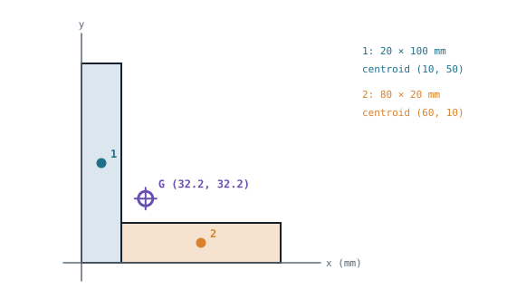

## The idea
Every equilibrium and dynamics problem puts the weight $mg$ **at the centre of mass**. For a uniform rod that's obviously the middle, but for a bracket, a robot chassis or a gripper finger you have to work it out.

The idea comes straight from the parallel force system in [[Forces and moments]]: **the moment of the whole object's weight about a point equals the sum of the moments of all its parts about that point.**

$$\bar x \sum W_i = \sum W_i x_i \quad\Rightarrow\quad \boxed{\bar x = \frac{\sum A_i\,x_i}{\sum A_i}}$$

For a flat plate of uniform thickness and density, the weight of each part is proportional to its area, so you can use areas directly. The same works for $\bar y$ with the $y_i$ values.

## Composite shapes
Split the shape into simple pieces whose centroids you know:

| Shape | Centroid |
|---|---|
| Rectangle | The middle |
| Triangle | $\tfrac13$ of the height up from the base |
| Circle or semicircle | Centre; a semicircle's is $4r/3\pi$ from the flat edge |

Then tabulate area × position and divide. **Holes count as negative area.**

### Worked example: an L-shaped bracket
The bracket is a 20 × 100 mm upright with an 80 × 20 mm foot attached at the bottom right. Find its centre of mass from the bottom-left corner.

> [!example]- Answer
> | Part | A (mm²) | $x_i$ | $y_i$ | $A x_i$ | $A y_i$ |
> |---|---|---|---|---|---|
> | 1 upright | 2000 | 10 | 50 | 20 000 | 100 000 |
> | 2 foot | 1600 | 60 | 10 | 96 000 | 16 000 |
> | Total | 3600 | | | 116 000 | 116 000 |
>
> $\bar x = 116\,000/3600 = $ **32.2 mm** · $\bar y = 116\,000/3600 = $ **32.2 mm**
> G sits in the empty corner of the L, outside the material. That's normal for hollow or bent shapes.

## Curved shapes: integrate with strips
When the edge is a curve $y(x)$, slice the shape into thin vertical strips of width $\delta x$:
1. **Whole shape:** area $A = \int y\,dx$, and its moment is $A\bar x$.
2. **One strip** at distance x: area $y\,\delta x$, moment $x\,y\,\delta x$.
3. **Equate** the whole shape's moment with the total of all the strips:

$$\boxed{\bar x = \frac{\int x\,y\,dx}{A}} \qquad \boxed{\bar y = \frac{\int \tfrac12 y^2\,dx}{A}}$$

For $\bar y$, each vertical strip's own centroid is halfway up it, at $y/2$, which is where the $\tfrac12 y^2$ comes from. (Equivalently, use horizontal strips of width $x(y)$: $\bar y = \int y\,x(y)\,dy / A$.)

### Worked example: under a parabola
Find the centroid of the region under $y = x^2$ from $x = 0$ to $x = 2$.

> [!example]- Answer
> $A = \int_0^2 x^2\,dx = [x^3/3]_0^2 = 8/3$
> $\int_0^2 x \cdot x^2\,dx = [x^4/4]_0^2 = 4$ → $\bar x = 4/(8/3) = $ **1.5**
> $\int_0^2 \tfrac12 x^4\,dx = [x^5/10]_0^2 = 3.2$ → $\bar y = 3.2/(8/3) = $ **1.2**
> Sense check: the shape is fatter on the right, so $\bar x$ is past the halfway point (1), and it's flat along the bottom, so $\bar y$ is low.

## Why it matters for robots
- **Tipping:** a mobile robot tips over when its centre of mass moves outside the wheelbase, for example when an arm reaches out or it climbs a slope. Keeping G low and central keeps it stable.
- **Motor torque:** an arm joint has to hold the load's weight at the distance to its centre of mass, $T = mg\,d$. Moving the motor close to the base reduces that d for the joints above it.
- **Inertia:** a uniform slender rod's moment of inertia about its centre, $I = \tfrac1{12}mL^2$, assumes the mass is spread evenly with G at the middle. Real links with holes, bosses and fittings have their G elsewhere.

## Common mistakes
- **Adding a hole instead of subtracting it.**
- **Measuring every $x_i$ from a different origin.** Pick one corner and stick to it.
- **Forgetting the ½ in the $\bar y$ integral.**
- **Assuming G must be on the material.** It doesn't have to be.

## Check yourself
> [!question]- 1. A 100 × 60 mm plate has a 20 mm diameter hole centred at (70, 30) mm. Find $\bar x$.
> Plate: 6000 mm² at x = 50. Hole: $\pi \times 10^2 = 314$ mm² at x = 70.
> $\bar x = (6000 \times 50 - 314 \times 70)/(6000 - 314) = 278\,009/5686 = $ **48.9 mm**. The hole pulls G slightly left, away from it. $\bar y = 30$ mm by symmetry.

> [!question]- 2. A right-angled triangle has a 90 mm base along the x-axis and a 60 mm height up the y-axis. Where's its centroid?
> One third along each leg from the right angle: **(30, 20) mm**.

Back to [[WM1AC/index|WM1AC]], or practise in [[WM1AC practice questions]].
