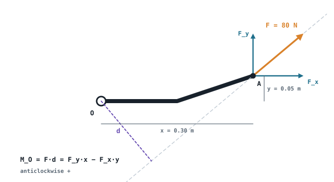

## The idea
Weeks 1–3 were **kinematics**: how things move, with no mention of why. Week 4 starts **kinetics**: the forces that cause the motion. Before you can say whether a mechanism stays put or accelerates, you need two tools:
- **Forces**, which push or pull a body in a direction
- **Moments**, which are a force's tendency to **rotate** a body about a point

A spanner on a stubborn bolt is the everyday example: the same push does more if you hold the end of the handle, because the turning effect depends on *how far* the force is from the bolt as well as how big it is.

## Moment of a force
The moment of a force F about a point O is

$$\boxed{M_O = F\,d} \quad [\text{N·m}]$$

where **d is the perpendicular distance** from O to the force's **line of action** (the moment arm), not just the distance to where the force is applied.

- **Sign convention:** anticlockwise is **+**, clockwise is **−** (the same as the right-hand rule in 2D: anticlockwise in the x–y plane points along +z).
- A force whose line of action passes **through** O has no moment about O, because d = 0.
- In 3D it's the cross product $\mathbf M_O = \mathbf r \times \mathbf F$, with $\mathbf r$ from O to any point on the line of action (see [[Vectors]]).

## Varignon's theorem: use the components
Finding d directly takes trigonometry and is easy to get wrong. The **principle of moments** (Varignon's theorem) says the moment of a force equals the **sum of the moments of its components**. For a force acting at a point (x, y) from O:

$$\boxed{M_O = F_y\,x - F_x\,y}$$

Each component has an easy perpendicular distance: $F_y$ is vertical, so its arm is the horizontal distance x; $F_x$ is horizontal, so its arm is the vertical distance y. Think about each one's turning direction to get the sign.

### Worked example
In the diagram, an 80 N force acts at 40° above the horizontal at A, which is 0.30 m to the right of O and 0.05 m above it. Find the moment about O and the perpendicular distance d.

> [!example]- Answer
> $F_x = 80\cos40° = 61.3$ N · $F_y = 80\sin40° = 51.4$ N
> $F_y$ pushes up at 0.30 m to the right of O: anticlockwise, $+51.4 \times 0.30 = +15.4$ N·m
> $F_x$ pushes right at 0.05 m above O: clockwise, $-61.3 \times 0.05 = -3.06$ N·m
> **$M_O = 15.4 - 3.06 = 12.4$ N·m anticlockwise**
> $d = M_O/F = 12.4/80 = 0.155$ m. That's shorter than the 0.30 m to A, because the force is angled.

## Couples
A **couple** is two forces that are equal in size, opposite in direction and parallel, separated by a perpendicular distance d:

$$M = F\,d$$

- The two forces cancel, so a couple produces **no net force, only rotation**.
- A couple moment is a **free vector**: it has the same effect wherever it's applied on the body. That's why a couple doesn't need a "point".
- Several couples simply add: $M_R = \sum \pm F d$.

*Example: two hands push a steering wheel with 30 N each, on opposite sides of a 0.36 m diameter rim. The couple is 30 × 0.36 = **10.8 N·m**, whatever point you take it about.*

## Resultant of a force system
Several forces and couples on a body can be replaced by **one resultant force at a point O plus one couple**, which has the same external effect:
1. Forces through O move to O unchanged.
2. A force not through O can be moved to O if you **add a couple** equal to its moment about O.
3. Add everything up:

$$F_{Rx} = \sum F_x \qquad F_{Ry} = \sum F_y \qquad (M_R)_O = \sum M + \sum F d$$

**Special cases:**
| System | Simplifies to |
|---|---|
| Concurrent (all lines of action meet at O) | Just the resultant force at O; zero moment |
| Parallel forces | One force $F_R = \sum F$, placed at d where $F_R d = \sum F_i d_i$ |
| General coplanar | One force placed so that $F_R d = (M_R)_O$ |

The parallel case is exactly how a **centre of mass** works: the total weight acts where its moment equals the sum of the parts' moments (see [[Centre of mass]]).

### Worked example
A horizontal bar has a 200 N downward load 1 m from O, a 100 N downward load 3 m from O, and a 50 N·m clockwise couple. Find the resultant force, the resultant moment about O, and where a single equivalent force would act.

> [!example]- Answer
> $F_R = 200 + 100 = 300$ N downward
> $(M_R)_O = -200(1) - 100(3) - 50 = -550$ N·m, so **550 N·m clockwise**
> One equivalent force: 300 N downward at $d = 550/300 = 1.83$ m from O

## Method for moment questions
1. Draw the body with **all dimensions** and an x–y axis.
2. Resolve each force into x and y components.
3. Find each component's perpendicular distance to the point.
4. Add the moments with signs, and give the answer as a **magnitude and a direction** (clockwise or anticlockwise).

## Common mistakes
- **Using the distance to the point of application** instead of the perpendicular distance to the line of action.
- **Dropping the direction.** "12.4 N·m" alone loses marks; say anticlockwise.
- **Mixing mm and m.** Moments in N·m need distances in metres.
- **Forgetting that a couple has no point.** Its moment is the same about every point.

## Check yourself
> [!question]- 1. A 150 N force acts straight down at the end of a 0.4 m horizontal arm pinned at O. What's the moment about O?
> $M = 150 \times 0.4 = 60$ N·m **clockwise**.

> [!question]- 2. The same 150 N force now acts along the arm, pulling away from O. What's the moment?
> **Zero.** Its line of action passes through O, so d = 0.

> [!question]- 3. A 50 N force at 30° below the horizontal (pointing right) acts at (0.2, 0.1) m from O. Find $M_O$.
> $F_x = 43.3$ N, $F_y = -25$ N. $M_O = F_y x - F_x y = (-25)(0.2) - (43.3)(0.1) = -5 - 4.33 = -9.33$ N·m, so **9.33 N·m clockwise**.

Next: using moments and forces to find unknowns, in [[Static equilibrium and free body diagrams]].
