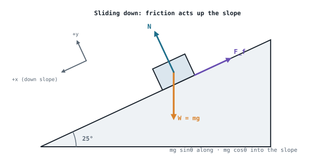

## The idea
[[Static equilibrium and free body diagrams|Static equilibrium]] is the case where the forces balance. When they don't, the body accelerates, and **Newton's second law** tells you how much:

$$\boxed{\sum \mathbf F = m\mathbf a}$$

Written in components, it's the equilibrium equations with $ma$ on the right instead of zero:

$$\sum F_x = ma_x = m\ddot x \qquad \sum F_y = ma_y = m\ddot y$$

Friction appears in almost every real problem, because it's what a robot's wheels push against, and what a gripper relies on to hold things.

## Friction
Friction acts **along the contact surface**, **opposing the sliding** (or the tendency to slide).

| | Formula | When |
|---|---|---|
| **Static** | $F_s \le \mu_s N$ | Not sliding. It's only as big as it needs to be, up to the limit $\mu_s N$ |
| **Kinetic** | $F_k = \mu_k N$ | Sliding. A fixed value |

- $N$ is the **normal reaction**. Find it from the force balance **perpendicular to the surface**. It's only equal to $mg$ on flat ground with no other vertical forces. On a slope, $N = mg\cos\theta$.
- Usually $\mu_k < \mu_s$: it takes more force to *start* sliding than to keep sliding. That's one reason a mechanism's start-up effort is higher than its running effort.
- **Will it slip?** Work out the friction needed to stay put and compare it with $\mu_s N$. If it needs more than that, it slides, and you switch to $\mu_k$.

## Method for dynamics problems
1. **Draw a free body diagram** with every force, and choose axes **along and perpendicular to the motion** (along the slope, for example).
2. Draw the **kinetic diagram** next to it: an arrow $m\mathbf a$ in the direction of acceleration. The FBD and the kinetic diagram must be equivalent.
3. Write $\sum F = ma$ in each direction, **for each body**.
4. Add the **constraints**: bodies joined by a taut, inextensible rope share the same acceleration size; friction is $\mu N$.
5. Solve, then sense-check the direction and size.

## Worked example: a block on a slope
A 12 kg block sits on a 25° slope with $\mu_s = 0.3$ and $\mu_k = 0.2$. Does it slide? If so, find its acceleration.

> [!example]- Answer
> Perpendicular to the slope (no acceleration that way): $N = mg\cos25° = 12 \times 9.81 \times 0.906 = 106.7$ N
> **Does it slip?** To stay still, friction would need to equal $mg\sin25° = 49.8$ N. The maximum available is $\mu_s N = 0.3 \times 106.7 = 32.0$ N, which isn't enough, so **it slides**. (Shortcut: it slides whenever $\tan\theta > \mu_s$; $\tan25° = 0.466 > 0.3$.)
> Along the slope (down = +): $mg\sin25° - \mu_k N = ma$
> $49.8 - 0.2 \times 106.7 = 12a$ → $49.8 - 21.3 = 12a$ → **$a = 2.37$ m/s²** down the slope
> Notice the mass cancels if you write it symbolically: $a = g(\sin\theta - \mu_k\cos\theta)$.

## Worked example: connected bodies
A 4 kg block on a table ($\mu_k = 0.25$) is tied by a light rope over a smooth pulley to a 3 kg mass hanging over the edge. Find the acceleration and the rope tension.

> [!example]- Answer
> Same rope, so both move with the same $a$. Take the direction of motion as positive for each body.
> **Hanging mass:** $3g - T = 3a$
> **Table block:** $T - 0.25(4g) = 4a$
> Add the two equations (T cancels): $3g - g = 7a$ → $a = 2 \times 9.81/7 = $ **2.80 m/s²**
> $T = 3(9.81 - 2.80) = $ **21.0 N**, which is less than the hanging weight (29.4 N), as it must be for the mass to accelerate downwards.

## Rotation: ΣM = Iα
For a body turning about a fixed point, the rotational version of $F = ma$ is

$$\boxed{\sum M = I\alpha}$$

For a single small mass at radius r, the **mass moment of inertia** is $I = mr^2$. Applying it to a pendulum: the tangential force $F_t$ gives a moment $F_t r = mr^2\alpha$, so $\alpha = F_t/(mr)$.

### Worked example: a pendulum at release
A 1.5 kg ball on a 0.8 m string is held at 20° from vertical and released. At the moment of release, find the angular acceleration and the string tension.

> [!example]- Answer
> At release it isn't moving yet ($\omega = 0$), so there's no normal (centripetal) acceleration.
> **Tangential:** $F_t = mg\sin20° = 1.5 \times 9.81 \times 0.342 = 5.03$ N → $\alpha = F_t/(mr) = 5.03/(1.5 \times 0.8) = $ **4.19 rad/s²**
> **Along the string:** $T - mg\cos20° = m\omega^2 r = 0$ → **$T = 13.8$ N**
> Once it's swinging, $\omega \ne 0$ and the tension rises by $m\omega^2 r$.

## Why it matters for robots
- **Wheel traction:** a robot can't accelerate harder than friction allows: $a_{max} = \mu_s g$ on flat ground. Push the motor beyond that and the wheels spin.
- **Motor sizing:** the force a drive must supply is $ma$ plus friction or rolling resistance plus any slope. The same sum appears in [[Sizing a drive motor]].
- **Mechanisms:** a slider-crank's joint forces come from $\sum F = ma$ on the slider and $\sum M = I\alpha$ on the rod.

## Common mistakes
- **Taking $N = mg$ on a slope**, or when another force pushes down or pulls up.
- **Using $\mu_s$ for something that's already sliding.**
- **Friction in the wrong direction.** It always opposes the sliding, so check which way the body would move without it.
- **One equation for two bodies.** Each body gets its own $\sum F = ma$, linked by the rope tension.

## Check yourself
> [!question]- 1. A 20 kg crate on the floor ($\mu_k = 0.3$) is pushed horizontally with 100 N. Find its acceleration.
> $N = 196.2$ N, friction $= 58.9$ N. $a = (100 - 58.9)/20 = $ **2.06 m/s²**.

> [!question]- 2. What's the steepest slope a robot can climb at constant speed if its wheels have $\mu_s = 0.6$ (ignore rolling resistance)?
> Grip runs out when $\tan\theta = \mu_s$: $\theta = \tan^{-1}(0.6) = $ **31°**.

> [!question]- 3. Why does a mechanism need more torque to start than to keep running?
> Static friction is higher than kinetic friction, the motor has to accelerate all the moving masses from rest ($\sum F = ma$, $\sum M = I\alpha$), and at some positions (a slider-crank near dead centre) the crank has little leverage.

Next: where the weight actually acts, in [[Centre of mass]].
