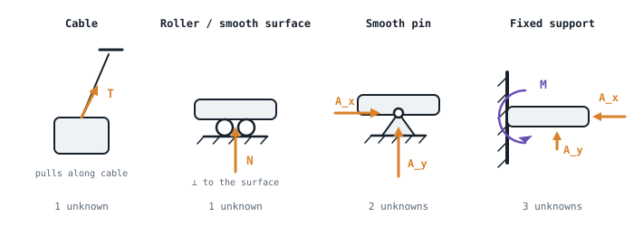
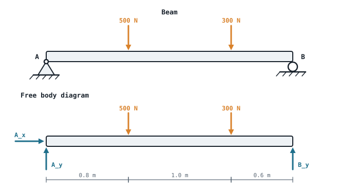

## The idea
A body is in **equilibrium** when it isn't accelerating, and in **static equilibrium** when it stays at rest. For a rigid body that needs two things at once:
- **No net force**, so it doesn't start translating
- **No net moment**, so it doesn't start rotating

In 2D that gives three equations:

$$\boxed{\sum F_x = 0 \qquad \sum F_y = 0 \qquad \sum M_O = 0}$$

Three equations means **at most three unknowns per body**. Those unknowns are usually support reactions or the force in a link, which is exactly what you need to size a pin, a bearing or a motor.

## Newton's three laws (the foundation)
1. A body at rest, or moving at constant velocity in a straight line, stays that way unless a **net** force acts on it.
2. $\sum \mathbf F = m\mathbf a$. Equilibrium is the special case $\mathbf a = 0$.
3. Action and reaction are **equal, opposite and collinear**. A pin pushes on a beam exactly as hard as the beam pushes on the pin.

A car at constant speed is in equilibrium: the traction force exactly equals the drag. While it's speeding up, it isn't, and the difference is $ma$ (see [[Friction and Newton's second law]]).

## Supports: what each one can push back with
A support **resists the motions it prevents**. Replace each support with the reactions it can apply:

| Support | Stops | Reactions | Unknowns |
|---|---|---|---|
| Cable or rope | Moving away along the cable | Tension, pulling along the cable | 1 |
| Roller or smooth surface | Moving into the surface | A normal force, perpendicular to the surface | 1 |
| Smooth pin (revolute joint) | Translation in any direction | $A_x$ and $A_y$; no moment, since it can still rotate | 2 |
| Fixed support (welded or clamped) | Translation **and** rotation | $A_x$, $A_y$ and a moment $M_A$ | 3 |

If you guess a reaction's direction wrong, nothing breaks: the answer just comes out **negative**, meaning it acts the other way.

**Two-force members:** a link pinned at both ends with no load in between can only carry force **along its length**, in tension or compression. That turns two unknowns ($A_x$, $A_y$) into one (the force along the link). Connecting rods and hydraulic cylinders are usually two-force members.

## The free body diagram (FBD)
You can't write the equilibrium equations reliably without one. An FBD shows **the body on its own** with every external force on it:
1. **Isolate** the body: draw it with nothing attached.
2. **Draw axes.**
3. **Add the applied loads**, including the weight $mg$ at the centre of mass.
4. **Replace each support** with its reactions from the table above.
5. **Add dimensions and angles.**

## Worked example: a beam on a pin and a roller
A 2.4 m beam is pinned at A and rests on a roller at B. It carries 500 N at 0.8 m from A and 300 N at 1.8 m from A. Ignore the beam's weight. Find the reactions.

> [!example]- Answer
> **Unknowns:** $A_x$, $A_y$ (pin) and $B_y$ (roller): three, so it's solvable.
> **Moments about A** (this kills $A_x$ and $A_y$, so only one unknown is left):
> $\sum M_A = 0$: $B_y(2.4) - 500(0.8) - 300(1.8) = 0$ → $B_y = 940/2.4 = $ **391.7 N ↑**
> $\sum F_y = 0$: $A_y + 391.7 - 500 - 300 = 0$ → **$A_y = 408.3$ N ↑**
> $\sum F_x = 0$: no horizontal loads, so **$A_x = 0$**
> **Check:** moments about B: $-A_y(2.4) + 500(1.6) + 300(0.6) = -980 + 800 + 180 = 0$ ✓

**The trick that makes these quick:** take moments about the point with the **most unknowns** (usually a pin). They drop out, and you solve for one unknown straight away.

## Worked example: a hanging load (concurrent forces)
A 25 kg sign hangs from two cables meeting at a ring. The left cable is at 30° above the horizontal and the right one at 60°. Find both tensions.

> [!example]- Answer
> The forces all meet at the ring, so moments give nothing; use the two force equations. $W = 25 \times 9.81 = 245.3$ N.
> $\sum F_x = 0$: $T_2\cos60° = T_1\cos30°$ → $T_1 = 0.577\,T_2$
> $\sum F_y = 0$: $T_1\sin30° + T_2\sin60° = 245.3$ → $0.289T_2 + 0.866T_2 = 245.3$
> **$T_2 = 212$ N, $T_1 = 123$ N.** The steeper cable carries more of the load.

## Common mistakes
- **Leaving a reaction off the FBD**, usually the horizontal reaction at a pin.
- **Taking moments about a point where nothing cancels**, which leaves you with simultaneous equations you didn't need.
- **Putting the weight in the wrong place.** It acts at the centre of mass, which for a uniform beam is the middle.
- **Mixing up which forces belong to which body** when a machine has several parts. Draw a separate FBD for each part, with equal and opposite forces at the shared pins.

## Check yourself
> [!question]- 1. A 2 m cantilever is fixed into a wall at A and carries 150 N at its free end. Find the reactions at A.
> $A_x = 0$, $A_y = 150$ N ↑, and a moment $M_A = 150 \times 2 = 300$ N·m **anticlockwise** (it resists the load trying to turn the beam clockwise).

> [!question]- 2. A uniform 40 kg plank, 3 m long, rests on supports at its two ends. A 70 kg person stands 1 m from the left end. Find both support forces.
> Weights: 392 N at 1.5 m and 687 N at 1 m. Moments about the left end: $R_R(3) = 392(1.5) + 687(1) = 1275$ → $R_R = 425$ N. Then $R_L = 392 + 687 - 425 = $ **654 N**.

> [!question]- 3. How many unknowns does a beam with a fixed support at one end and a roller at the other have, and why is that a problem?
> 3 + 1 = **4 unknowns**, but only 3 equations. It's **statically indeterminate**: you'd need the beam's stiffness to solve it, which is beyond this module.

Next: what happens when the forces *don't* balance, in [[Friction and Newton's second law]].
