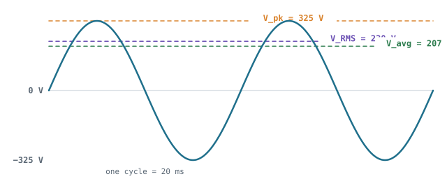

## The idea
Mains electricity is a sine wave: it pushes current one way, then the other, **50 times a second** in the UK. The "230 V" printed on everything isn't the top of that wave. It's the **RMS** value, the steady DC voltage that would heat a kettle by the same amount. The wave itself peaks at **325 V**, and any part connected to mains has to survive that peak.

## The three numbers
| Symbol | Name | What it is | UK mains |
|---|---|---|---|
| $V_{pk}$ | Peak | The top of the wave | 325 V |
| $V_{RMS}$ | RMS | The heating-equivalent value. What meters and labels quote | 230 V |
| $V_{avg}$ | Average | The mean height of one hump of the wave | 207 V |

| Convert | Multiply by |
|---|---|
| RMS → peak | $\sqrt2 \approx 1.41$ |
| Peak → RMS | $1/\sqrt2 \approx 0.707$ |
| Peak → average | $2/\pi \approx 0.637$ |
| RMS → average | $0.9$ |

## Where the numbers come from
**RMS** means *root of the mean of the square*. We square because heating power goes as $V^2$.

1. The wave is $V = V_{pk}\sin\theta$, so $V^2 = V_{pk}^2\sin^2\theta$.
2. Over a whole cycle, $\sin^2\theta$ averages to exactly $\tfrac12$.
3. So the mean of the square is $\tfrac12 V_{pk}^2$, and its root is

$$V_{RMS} = \frac{V_{pk}}{\sqrt2} \quad\Rightarrow\quad V_{pk} = \sqrt2 \times 230 = 325.3\ \text{V}$$

**Average of one hump** = area ÷ width. The area under $\sin\theta$ from $0$ to $\pi$ is exactly 2, and the width is $\pi$:

$$V_{avg} = \frac{2}{\pi}V_{pk} = 0.637\,V_{pk} \qquad \frac{V_{avg}}{V_{RMS}} = \frac{0.637}{0.707} = 0.9$$

The same ratios apply to current through a resistive load, so $I_{avg} = 0.9\,I_{RMS}$. You'll need that for [[Bridge rectifiers|bridge losses]].

## Worked example
A robot's charger is plugged into a 110 V RMS (US) supply. What peak voltage must its rectifier survive, and what's the average of each hump?

> [!example]- Answer
> $V_{pk} = 1.41 \times 110 = 155.6$ V. $V_{avg} = 0.637 \times 155.6 = 99.1$ V (or $0.9 \times 110 = 99$ V).
> A diode rated $V_{RRM} = 400$ V would be fine. At 230 V you'd want 600–800 V.

## Common mistakes
- Using 230 V where the question needs the peak. Capacitors charge to the **peak**, and diodes must block the **peak**.
- Using RMS current for a diode's loss. Diodes use **average** current (see [[Bridge rectifiers]]).
- Trusting a cheap multimeter on PWM. Ordinary meters only read RMS correctly for a clean 50 Hz sine. Use a **true-RMS** meter or a scope.

## Check yourself
> [!question]- 1. A sine wave has a peak-to-peak voltage of 40 V. What's its RMS value?
> Peak = 20 V, so RMS = 0.707 × 20 = **14.1 V**.

> [!question]- 2. Why is RMS defined with a square?
> Because heating power in a resistor is $V^2/R$. Averaging $V^2$ gives a voltage that delivers the same power as DC.
