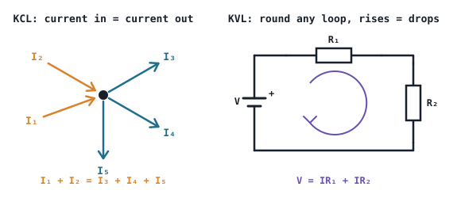

## The idea
Two rules let you analyse any circuit. Both are just conservation laws:
- **KCL (current law):** charge can't pile up at a junction, so **current in = current out**.
- **KVL (voltage law):** energy is conserved round a loop, so **the voltage rises equal the voltage drops**.

$$\text{KCL: } \sum I = 0 \qquad \text{KVL: } \sum V = 0 \text{ round any closed loop}$$

**Sign conventions:** count currents into a node as + and out as −. If a current you solve for comes out **negative**, it simply flows the opposite way to the arrow you drew. Keep the sign and carry on.

**Sources in a loop:** a source that pushes the same way as the others *adds*; one turned round *subtracts*. Three cells of 20, 10 and 20 V with the 10 V reversed give $20 - 10 + 20 = 30$ V.

## Series and parallel
| | Series | Parallel |
|---|---|---|
| Same for each part | Current | Voltage |
| Total resistance | $R_T = R_1 + R_2 + \dots$ | $\dfrac{1}{R_T} = \dfrac{1}{R_1} + \dfrac{1}{R_2} + \dots$ |
| Two resistors | | $R_T = \dfrac{R_1R_2}{R_1 + R_2}$ (product over sum) |

**Voltage divider** (two resistors in series): $V_{2} = V\,\dfrac{R_2}{R_1 + R_2}$
**Current divider** (two in parallel): $I_{2} = I\,\dfrac{R_3}{R_2 + R_3}$, the current through one branch uses the *other* branch's resistance on top.

## The method for any series–parallel circuit
1. Reduce the network to one total resistance $R_T$.
2. Total current $I_T = V/R_T$.
3. Work back out: the voltage across each block, then each branch current.
4. **Check KVL** (the drops add up to the supply) and **KCL** (the branches add up to the total).
5. **Check the power balance:** the power dissipated in the resistors, $\sum I^2R$, must equal the power from the sources, $\sum VI$.

The power balance is the best check there is. If it doesn't balance, something upstream is wrong.

## Worked example
A 12 V supply feeds $R_1 = 4\ \Omega$ in series with $R_2 = 6\ \Omega$ and $R_3 = 12\ \Omega$ in parallel. Find every current and check the power balance.

> [!example]- Answer
> $R_2 \parallel R_3 = \dfrac{6 \times 12}{18} = 4\ \Omega$, so $R_T = 4 + 4 = 8\ \Omega$ and $I_T = 12/8 = 1.5$ A.
> $V_{R1} = 1.5 \times 4 = 6$ V, so the parallel pair gets $12 - 6 = 6$ V.
> $I_2 = 6/6 = 1$ A, $I_3 = 6/12 = 0.5$ A. KCL: $1 + 0.5 = 1.5$ ✓
> Powers: $1.5^2 \times 4 = 9$ W, $1^2 \times 6 = 6$ W, $0.5^2 \times 12 = 3$ W → total **18 W** $= 12 \times 1.5$ ✓

## Common mistakes
- Adding parallel resistances directly. Parallel always gives *less* than the smallest resistor.
- In a current divider, putting the branch's own resistance on top.
- Throwing away a negative answer. It's information: the current flows the other way.

## Check yourself
> [!question]- 1. 10 Ω and 15 Ω in parallel?
> $\dfrac{150}{25} = 6\ \Omega$.

> [!question]- 2. A 9 V supply across 1 kΩ and 2 kΩ in series. Voltage across the 2 kΩ?
> $9 \times \dfrac{2}{3} = 6$ V.
