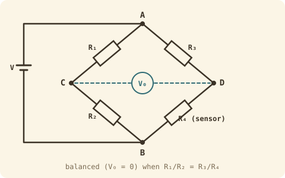

## The idea
Sensors like thermistors, strain gauges and pressure sensors change their resistance by a tiny amount. A **Wheatstone bridge** turns that tiny change into a voltage you can measure. It's two voltage dividers side by side, and you measure the *difference* between their middles.

## The bridge
Each side is a voltage divider. Measured from B:

$$V_C = V\frac{R_2}{R_1 + R_2} \qquad V_D = V\frac{R_4}{R_3 + R_4} \qquad V_0 = V_C - V_D$$

It's **balanced** ($V_0 = 0$) when the two dividers split the voltage the same way:

$$\frac{R_1}{R_2} = \frac{R_3}{R_4} \quad\Rightarrow\quad R_4 = \frac{R_2 R_3}{R_1}$$

So if three resistors are known, you can find the fourth by adjusting until the meter reads zero. Because it measures a *difference*, noise that affects both sides equally cancels out.

## Thermistors
A thermistor is a resistor that changes a lot with temperature.
- **NTC** (negative temperature coefficient): resistance **falls** as it gets hotter. The common type.
- **PTC** (positive temperature coefficient): resistance **rises**. Often used as resettable fuses.

In robots they sense the temperature of **battery packs, motors and power electronics**, limit inrush current, and trigger thermal shutdowns.

**The β model** (temperatures in **kelvin**):
$$R(T) = R_0 \exp\!\left[B\left(\frac{1}{T} - \frac{1}{T_0}\right)\right]$$
$R_0$ is the resistance at $T_0$ (usually 25 °C = 298.15 K) and $B$ is from the datasheet.

**In a bridge** with the thermistor in one arm and $R_0$ in the other three, it balances at 25 °C, and
$$V_0 = V_{ex}\left(\frac{R(T)}{R(T) + R_0} - \frac{1}{2}\right)$$
Near 25 °C the output changes by roughly $\dfrac{V_{ex}}{4}\,\alpha$ per kelvin, where $\alpha = -B/T_0^2$.

## Worked example
A 10 kΩ NTC thermistor ($B = 3950$ K) sits in a bridge with three 10 kΩ resistors, fed with 3.3 V. What's the output at **0 °C**?

> [!example]- Answer
> $T = 273.15$ K. $\dfrac{1}{273.15} - \dfrac{1}{298.15} = 0.000307$, × 3950 = 1.213
> $R = 10\,000\,e^{1.213} \approx 33.6$ kΩ (colder, so higher resistance for an NTC)
> $V_0 = 3.3\left(\dfrac{33.6}{43.6} - 0.5\right) = 3.3 \times 0.271 = $ **+0.89 V**
> Sensitivity near 25 °C: $\alpha = -3950/298.15^2 = -0.0444$ K⁻¹, so about $\frac{3.3}{4}(-0.0444) = -37$ mV per °C.

## Getting accurate readings
| Error source | Fix |
|---|---|
| Self-heating from the measuring current | Keep the excitation current small |
| Resistor tolerance in the bridge | 0.1% resistors |
| ADC offset and noise | Amplify and average |
| β not exact | Calibrate at two known temperatures |
| Long leads | 4-wire connection |

## Common mistakes
- Using °C in the β equation. It must be kelvin.
- Forgetting an NTC goes *up* when it's cold.

## Check yourself
> [!question]- 1. A bridge has $R_1 = 1$ kΩ, $R_2 = 2.2$ kΩ, $R_3 = 4.7$ kΩ. What $R_4$ balances it?
> $R_4 = \dfrac{2.2 \times 4.7}{1} = 10.34$ kΩ.
