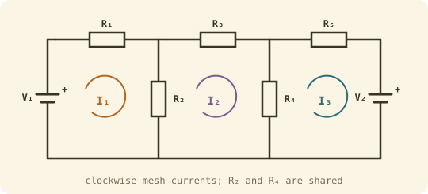

## The idea
Give every loop ("mesh") in the circuit its own current going round clockwise. Write KVL for each loop and you get one equation per mesh, which fit neatly into a matrix. Solve it and you have every current in the circuit at once.

A typical robot example: the main supply ($V_1$) and a backup battery ($V_2$) both feed a motor drive. Simplified, that's two sources and five resistors in three meshes.

## Building the matrix by inspection
$$\begin{bmatrix} R_1 + R_2 & -R_2 & 0 \\ -R_2 & R_2 + R_3 + R_4 & -R_4 \\ 0 & -R_4 & R_4 + R_5 \end{bmatrix}\begin{bmatrix} I_1 \\ I_2 \\ I_3 \end{bmatrix} = \begin{bmatrix} V_1 \\ 0 \\ V_2 \end{bmatrix}$$

- **Diagonal:** the total resistance round that mesh.
- **Off-diagonal:** **minus** the resistance shared by the two meshes, or 0 if they share nothing. So the matrix is always symmetric.
- **Right-hand side:** the source voltage driving each mesh, or 0.

Then:
1. Solve for the mesh currents ([[Matrices and Cramer's rule|Cramer]], calculator or MATLAB).
2. An **outer** branch carries its own mesh current.
3. A **shared** branch carries the **difference** of the two mesh currents. A negative answer means it flows the other way.
4. **Power balance:** $\sum I^2R = \sum VI$.

## Worked example
$V_1 = 24$ V, $V_2 = 12$ V, $R_1 = 4$, $R_2 = 6$, $R_3 = 3$, $R_4 = 8$, $R_5 = 2\ \Omega$. Find every branch current and check the power balance.

> [!example]- Answer
> $$\begin{bmatrix} 10 & -6 & 0 \\ -6 & 17 & -8 \\ 0 & -8 & 10 \end{bmatrix}\begin{bmatrix} I_1 \\ I_2 \\ I_3 \end{bmatrix} = \begin{bmatrix} 24 \\ 0 \\ 12 \end{bmatrix} \qquad \Delta = 700$$
> $\Delta_1 = 3120$, $\Delta_2 = 2400$, $\Delta_3 = 2760$, so $I_1 = 4.457$ A, $I_2 = 3.429$ A, $I_3 = 3.943$ A.
> Branches: $I_{R1} = 4.457$, $I_{R3} = 3.429$, $I_{R5} = 3.943$ A.
> Shared: $I_{R2} = I_1 - I_2 = 1.029$ A, $I_{R4} = I_2 - I_3 = -0.514$ A (flows opposite to $I_2$'s direction).
> Resistors: $79.46 + 6.35 + 35.27 + 2.12 + 31.09 = 154.3$ W
> Sources: $24 \times 4.457 + 12 \times 3.943 = 107.0 + 47.3 = 154.3$ W ✓

## Common mistakes
- Positive off-diagonal terms. Shared resistances are always **negative** in this setup.
- Forgetting a resistor in a diagonal term: go all the way round the mesh.
- Reading a shared branch's current as one mesh current instead of the difference.

## Check yourself
> [!question]- 1. Write the matrix for $R_1 = 5$, $R_2 = 3$, $R_3 = 2$, $R_4 = 4$, $R_5 = 7\ \Omega$, $V_1 = 24$ V, $V_2 = 12$ V.
> $\begin{bmatrix} 8 & -3 & 0 \\ -3 & 9 & -4 \\ 0 & -4 & 11 \end{bmatrix}\begin{bmatrix} I_1 \\ I_2 \\ I_3 \end{bmatrix} = \begin{bmatrix} 24 \\ 0 \\ 12 \end{bmatrix}$, giving $I_1 = 3.78$, $I_2 = 2.08$, $I_3 = 1.85$ A.
