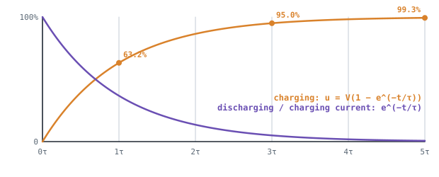

## The idea
A capacitor can't change its voltage instantly; it has to fill with charge through whatever resistance is in the way. So when you switch on an RC circuit, the voltage climbs along a curve instead of jumping. In a robot this happens every time the power supply charges the **capacitor bank** (DC link) in front of a motor drive through the cable resistance.

## The time constant
$$\tau = RC \quad \text{(seconds)}$$

| Time | 1τ | 2τ | 3τ | 4τ | 5τ |
|---|---|---|---|---|---|
| Charged to | 63.2% | 86.5% | 95.0% | 98.2% | 99.3% |

**After 5τ, call it fully charged (or discharged).**

## Deriving the curves
This is your first engineering **ODE** (ordinary differential equation): its answer is a *function* of time, not a number.

1. Component laws: $u_R = iR$ and $i = C\dfrac{du_C}{dt}$ (current is the rate of change of the capacitor's charge).
2. KVL round the loop while charging from $V$: $V = u_R + u_C = RC\dfrac{du_C}{dt} + u_C$.
3. Separate the variables and integrate from $u_C = 0$ at $t = 0$:

$$u_C(t) = V\left(1 - e^{-t/\tau}\right) \qquad i(t) = \frac{V}{R}e^{-t/\tau}$$

**Discharging** from $V_0$ (no source, so $RC\,\dfrac{du_C}{dt} + u_C = 0$):

$$u_C(t) = V_0\,e^{-t/\tau} \qquad i(t) = -\frac{V_0}{R}e^{-t/\tau}$$

The minus sign means the current now flows the other way.

## Energy
- A charged capacitor holds $E = \tfrac12 CV^2$.
- Charging it through a resistor always wastes **exactly as much energy as it stores**, whatever R is. Half the energy from the source becomes heat.

## Capacitors combine the opposite way to resistors
- **Parallel:** $C = C_1 + C_2$, same voltage rating. Two 500 µF, 24 V capacitors → 1000 µF, 24 V.
- **Series:** $\dfrac{1}{C} = \dfrac{1}{C_1} + \dfrac{1}{C_2}$, voltage ratings add. Two 500 µF, 24 V in series → 250 µF, 48 V.

## Worked example
A 12 V supply charges a 100 µF capacitor through 47 kΩ. Find τ, the voltage after 4.7 s and after 10 s, the time to reach 9 V, and the starting current.

> [!example]- Answer
> $\tau = 47\,000 \times 100\times10^{-6} = 4.7$ s
> At 4.7 s (1τ): $12(1 - e^{-1}) = 7.59$ V
> At 10 s: $12(1 - e^{-10/4.7}) = 12(1 - 0.119) = 10.57$ V
> To 9 V: $9 = 12(1 - e^{-t/4.7})$ → $e^{-t/4.7} = 0.25$ → $t = 4.7\ln 4 = 6.52$ s
> $i(0) = 12/47\,000 = 0.255$ mA. Stored when full: $\tfrac12 \times 100\times10^{-6} \times 12^2 = 7.2$ mJ.

## Common mistakes
- Using µF without the $10^{-6}$.
- Using the charging equation for a discharge.
- Taking a log of the wrong side: isolate $e^{-t/\tau}$ first, then take ln of both sides.

## Check yourself
> [!question]- 1. A 10 Ω, 220 µF circuit. How long until it's fully charged?
> $\tau = 2.2$ ms, so about $5\tau = 11$ ms.

> [!question]- 2. Why is it said a capacitor "looks like a short circuit" at switch-on?
> At $t = 0$ it has no voltage across it, so the current is the full $V/R$, as if the capacitor were a wire.
