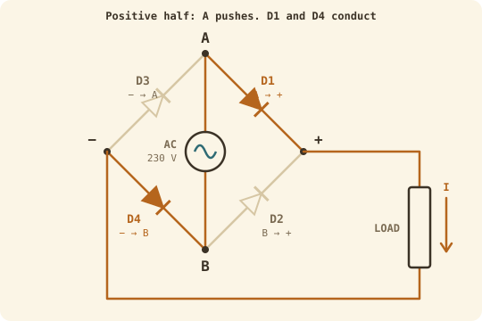
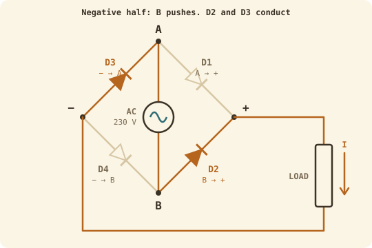
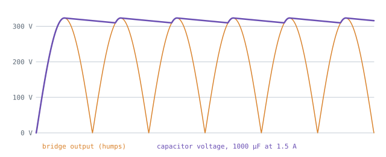

## The idea
A **diode** is a one-way valve for current. In the symbol, current can only flow the way the triangle points, and getting through costs a small, roughly fixed voltage, the **forward voltage $V_F \approx 1$ V**. Backwards, it blocks, up to its limit $V_{RRM}$.

One diode on its own (a *half-wave rectifier*) lets the positive half of the AC through and throws the negative half away. A **full bridge** uses four diodes arranged in a diamond so that *both* halves come out positive.

## How the bridge works
Name the four corners: **A** and **B** connect to the AC, **+** and **−** connect to the load.

| Diode | Allows current |
|---|---|
| D1 | A → + |
| D2 | B → + |
| D3 | − → A |
| D4 | − → B |

Two arrows point *into* +, two point *out of* −. So whatever the AC does, current can only arrive at + and leave from −. **It always goes through the load from + to −.**

**Positive half (A pushes):** A → D1 → + → load → − → D4 → B. D2 and D3 would need current to flow against their arrows, so they block.

**Negative half (B pushes):** B → D2 → + → load → − → D3 → A. Same direction through the load.

> [!important] The two things to remember
> 1. Current always passes through **exactly two diodes**. So the output peak is $V_{pk} - 2V_F$, and two diodes are always making heat.
> 2. The output is a row of positive humps, **two per AC cycle**: 100 per second at 50 Hz.

A **three-phase bridge** (6 diodes) on a three-phase supply gives six overlapping humps per cycle, which is nearly flat DC. That's what big industrial kit uses.

## Smoothing with a capacitor
The humps still drop to 0 V between peaks. A **capacitor** across the output works like a water tank: it fills at each peak, and the load drains it a little until the next hump refills it. The dip is the **ripple, $\Delta V$**.

**Deriving the ripple:**
1. Refills happen 100 times a second, so the gap is $\Delta t = \dfrac{1}{2F_{grid}} = 10$ ms.
2. In that gap the load takes charge $\Delta Q = I\,\Delta t$ (current is charge per second).
3. For a capacitor $Q = CV$, so the voltage drops by $\Delta V = \Delta Q / C$.

$$\boxed{\Delta V = \frac{I}{2\,F_{grid}\,C}}$$

The capacitor charges to the top of each hump, minus the two diode drops:

$$V_{C,max} = V_{pk} - 2V_F$$

## Heat in the bridge
1. Power = voltage × current. A conducting diode has a fixed $V_F$ across it, so $P = V_F \times i$ at every instant.
2. Averaged over time, $V_F$ is constant, so $P = V_F \times I_{avg}$. **Diodes use average current**, unlike resistors and MOSFETs, which use $I^2R$ with RMS.
3. Two diodes are always on, so $P = 2\,V_F\,I_{avg}$.
4. You're usually given RMS, and for these humps $I_{avg} = 0.9\,I_{RMS}$ (see [[AC values]]).

$$\boxed{P_{D(FB)} = 2 \times 0.9 \times V_F\,I_{D,RMS} = 1.8\,V_F\,I_{D,RMS}}$$

## Choosing a bridge from its datasheet
| Check | Rule | Why |
|---|---|---|
| $I_{F(AV)}$ | Above your current, with margin (~50%) | It sets how much average current it can carry without overheating |
| $V_{RRM}$ | Above the peak, 325 V on UK mains, with margin | When a diode is off, it has to block the full peak |
| $V_F$ | Lower is better | Less heat, slightly higher output |

## Worked example
A robot charger uses a GBPC12 bridge ($V_F = 1.1$ V, $I_{F(AV)} = 12$ A, $V_{RRM} = 800$ V) on 230 V mains. It draws **2 A RMS** and has a **4700 µF** smoothing capacitor. Find the bridge's heat, the capacitor's peak voltage and the ripple. Is the bridge suitable?

> [!example]- Answer
> $P_{D(FB)} = 1.8 \times 1.1 \times 2 = 3.96$ W
> $V_{C,max} = 325.3 - 2(1.1) = 323.1$ V
> $\Delta V = \dfrac{2}{2 \times 50 \times 4700\times10^{-6}} = \dfrac{2}{0.47} = 4.26$ V
> Suitable: 12 A ≫ 2 A, and 800 V > 325 V.

## Common mistakes
- Forgetting the **two** diode drops: it's $V_{pk} - 2V_F$, not $- V_F$.
- Forgetting µF is $\times10^{-6}$. 4700 µF = 0.0047 F.
- Using 50 instead of $2 \times 50$ in the ripple formula. A full bridge refills twice per cycle.
- Checking $V_{RRM}$ against 230 V instead of the 325 V peak.

## Check yourself
> [!question]- 1. In the positive half, why doesn't current go A → D3?
> D3 only allows − → A. Going A → − would be against its arrow, so it blocks.

> [!question]- 2. You double C. What happens to the ripple?
> It halves, because $\Delta V \propto 1/C$.

> [!question]- 3. A bridge with $V_F = 0.9$ V carries 3 A RMS. How much heat does it make?
> $1.8 \times 0.9 \times 3 = 4.86$ W.
