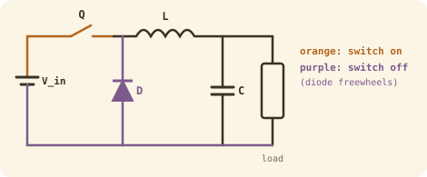
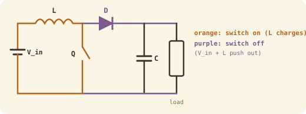

## The idea
A battery gives one voltage, but a robot needs several: one for the motors, one for the logic, one for the sensors. A **DC-DC converter** chops the input with a MOSFET ([[PWM]]), then smooths the result with an **inductor** (which stores energy in its current) and a **capacitor** (which stores energy in its voltage). The duty cycle $D$ sets the output.

## Buck (step-down)

- **Switch on:** the battery drives current through L into the load. L stores energy.
- **Switch off:** L keeps the current flowing (inductors resist sudden changes in current), and the diode completes the loop. This is called **freewheeling**.

$$\boxed{V_{out} = D\,V_{in}}$$

## Boost (step-up)

- **Switch on:** L is connected straight across the battery and charges up. The capacitor feeds the load.
- **Switch off:** the battery and L push *together* through the diode, so the output rises above $V_{in}$.

$$\boxed{V_{out} = \frac{V_{in}}{1-D}}$$

## Deriving both: volt-second balance
In steady state, an inductor's **average voltage over one cycle must be zero**. If it weren't, its current would keep growing every cycle. So (voltage × time while on) + (voltage × time while off) = 0.

**Buck.** On for $DT$: the inductor sits between $V_{in}$ and $V_{out}$, so $V_L = V_{in} - V_{out}$. Off for $(1-D)T$: the diode connects it to ground, so $V_L = -V_{out}$.

$$(V_{in} - V_{out})\,D = V_{out}\,(1-D) \;\Rightarrow\; V_{out} = D\,V_{in}$$

**Boost.** On: $V_L = V_{in}$. Off: $V_L = V_{in} - V_{out}$, which is negative.

$$V_{in}D + (V_{in} - V_{out})(1-D) = 0 \;\Rightarrow\; V_{out} = \frac{V_{in}}{1-D}$$

## Sizing the buck's L and C
**Inductor:** $V = L\,\dfrac{\Delta I}{\Delta t}$. While off, $V_L = V_{out}$ for a time $(1-D)/F_{SW}$, and the current changes by the ripple $\Delta I_L$:

$$\boxed{L = \frac{V_{out}(1-D)}{F_{SW}\,\Delta I_L}}$$

**Capacitor:** it absorbs the inductor's triangle-shaped ripple current:

$$\boxed{C_{out} \ge \frac{\Delta I_L}{8\,F_{SW}\,\Delta V_{out}}}$$

Higher frequency means a smaller L and C, which is why modern converters are tiny. The trade-off is more [[MOSFET power loss|switching loss]].

## Worked example
Step a 48 V robot battery down to 24 V at 5 A, switching at 100 kHz, with 10% ripple on both current and voltage. Find D, L and C.

> [!example]- Answer
> $D = 24/48 = 0.5$. $\Delta I_L = 0.1 \times 5 = 0.5$ A. $\Delta V = 0.1 \times 24 = 2.4$ V.
> $L = \dfrac{24 \times 0.5}{100\,000 \times 0.5} = 240\ \mu$H
> $C \ge \dfrac{0.5}{8 \times 100\,000 \times 2.4} = 0.26\ \mu$F

## Isolated or not?
| | Transformer-less (buck, boost) | Transformer-based (isolated) |
|---|---|---|
| How | Switch, inductor, capacitor | DC → high-frequency AC → transformer → rectified back to DC |
| Galvanic isolation | No: a fault passes to the load | Yes: protects the user and load |
| Efficiency | 90–98% | 80–95% |
| Size and cost | Small, cheap | Bulkier, costs more |
| Voltage ratio | Low to moderate | Extreme step-up or step-down |
| Outputs | One | One or several |

**Buck-boost** converters can go either way, which is useful when a battery sags below the output as it drains. *Synchronous* versions replace the diode with a second MOSFET to cut loss.

## Check yourself
> [!question]- 1. A boost converter takes 12 V and must output 36 V. What duty cycle?
> $36 = 12/(1-D)$ → $1 - D = 1/3$ → $D = 0.667$.

> [!question]- 2. In the buck L formula, which voltage goes on top, $V_{in}$ or $V_{out}$?
> $V_{out}$. During the off-time, the inductor has $V_{out}$ across it.
