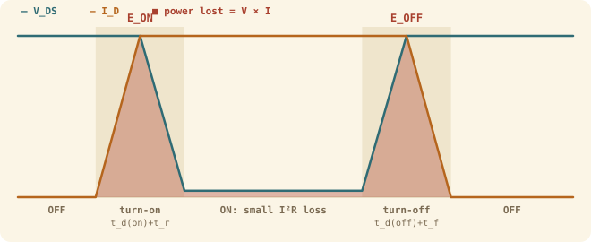

## The idea
A MOSFET wastes power in two separate ways:
- **Conduction loss:** while it's **fully on**, current flows through its small on-resistance $R_{DS(on)}$.
- **Switching loss:** while it's **changing state**, for a few nanoseconds there's a large voltage across it *and* a large current through it at the same time. This happens twice per cycle, so it grows with the switching frequency.

When it's off there's full voltage but no current, so no loss. When it's on there's full current but only a tiny voltage ($I \times R_{DS(on)}$), so a small loss. The red spikes are where both are large together.

## Conduction loss
Fully on, the MOSFET is just a resistor of value $R_{DS(on)}$, so

$$\boxed{P_{cond} = R_{DS(on)}\,I_D^2}$$

Because of the square, doubling the current quadruples this loss. That's why high-power systems use higher voltages (less current for the same power), and why MOSFETs are often put in parallel to share current.

## Switching loss, derived
1. During turn-on, the current first rises from 0 to $I_D$ while the voltage is still $V_{DD}$. Then the voltage falls to almost 0 while the current stays at $I_D$.
2. In each part, the power $V \times I$ ramps between 0 and $V_{DD}I_D$, which makes a **triangle** on a power–time graph.
3. Energy is the area under the power graph. A triangle's area is ½ × height × width, so over the whole switching time $t$:

$$E = \tfrac12\,V_{DD}\,I_D\,t$$

4. The datasheet splits the switching time into two parts each way:

$$E_{ON} = \frac{V_{DD} I_D}{2}\,\big(t_{d(on)} + t_r\big) \qquad E_{OFF} = \frac{V_{DD} I_D}{2}\,\big(t_{d(off)} + t_f\big)$$

5. There's one turn-on and one turn-off per cycle, $F_{SW}$ times a second, and energy per second is power:

$$\boxed{P_{SW} = (E_{ON} + E_{OFF})\,F_{SW}} \qquad \boxed{P_{MOSFET} = P_{cond} + P_{SW}}$$

(The full formula has an extra $Q_{rr}V_{DD}$ term for diode recovery charge. It's usually ignored at this level.)

## Worked example
An **IRFP140** ($R_{DS(on)} = 0.077$ Ω; $t_{d(on)} = 11$, $t_r = 44$, $t_{d(off)} = 53$, $t_f = 43$ ns) switches a 36 V motor supply at 8 A. Find the total loss at **20 kHz**, then at **150 kHz**.

> [!example]- Answer
> $P_{cond} = 0.077 \times 8^2 = 0.077 \times 64 = 4.93$ W
> $\dfrac{V_{DD}I_D}{2} = \dfrac{36 \times 8}{2} = 144$
> $E_{ON} = 144 \times (11+44)\times10^{-9} = 144 \times 55\times10^{-9} = 7.92\ \mu$J
> $E_{OFF} = 144 \times (53+43)\times10^{-9} = 144 \times 96\times10^{-9} = 13.82\ \mu$J
> At 20 kHz: $P_{SW} = 21.74\times10^{-6} \times 20\,000 = 0.43$ W, so **$P_{MOSFET} = 5.36$ W** (conduction dominates).
> At 150 kHz: $P_{SW} = 21.74\times10^{-6} \times 150\,000 = 3.26$ W, so **$P_{MOSFET} = 8.19$ W**. Switching loss has caught up.

## What drives each loss
| Change | $P_{cond}$ | $P_{SW}$ |
|---|---|---|
| Double the current | ×4 | ×2 |
| Double the voltage | no change | ×2 |
| Double the frequency | no change | ×2 |
| Pick a part with half the $R_{DS(on)}$ | ×½ | no change |
| Pick a faster part (shorter times) | no change | smaller |

## Common mistakes
- **Squaring the wrong thing.** Square the current only: $10^2 = 100$, not $100^2$.
- **Forgetting nanoseconds.** ns = $\times10^{-9}$.
- **Adding the wrong pair of times.** On = $t_{d(on)} + t_r$, off = $t_{d(off)} + t_f$.
- **kHz.** 13 kHz = 13 000 Hz.
- **Mixing numbers from two questions.** Sanity check: the loss can never exceed $V_{DD} \times I_D$.

## Check yourself
> [!question]- 1. An IRFP250 ($R_{DS(on)} = 0.075$ Ω; 14 + 43 ns on, 41 + 33 ns off) runs at 24 V, 10 A, 13 kHz. Total loss?
> $P_{cond} = 0.075 \times 100 = 7.5$ W. $E_{ON} = 120 \times 57\times10^{-9} = 6.84\ \mu$J, $E_{OFF} = 120 \times 74\times10^{-9} = 8.88\ \mu$J. $P_{SW} = 15.72\times10^{-6} \times 13\,000 = 0.20$ W. **Total ≈ 7.7 W.**

> [!question]- 2. Why is switching loss more important in DC-DC converters than in a simple motor PWM?
> Converters run at 100+ kHz to keep the inductor and capacitor small, and switching loss scales with frequency.

Next: what to do with all that heat, in [[Thermal design and heatsinks]].
