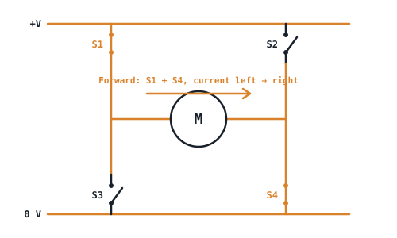
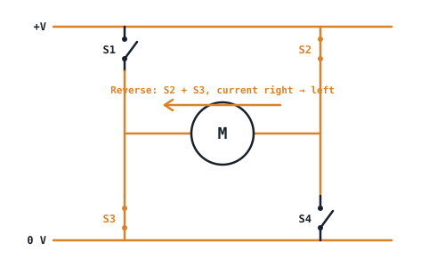

## The idea
The last link in the chain is a set of switches arranged so the motor gets the right voltage, polarity and timing. [[PWM]] sets the **speed**. The **arrangement** of switches sets the **direction**, and for brushless motors, which coil is energised.

## Brushed DC: the H-bridge
One MOSFET with PWM (a *single-switch chopper*) controls speed, but only in one direction. To reverse the motor you need to flip the polarity across it. Four switches in an **H** do that:

| Switches on | Result |
|---|---|
| S1 + S4 | Forward: current left → right through the motor |
| S2 + S3 | Reverse: current right → left |
| S3 + S4 | Brake: the motor's terminals are shorted, so its own back-EMF slows it fast |
| S1 + S3 or S2 + S4 | **Never.** This connects +V straight to 0 V through two switches (*shoot-through*), which destroys them. Drivers add *dead time* to prevent it |

The driver must also carry the motor's continuous current, and should limit it so a stalled motor doesn't overheat.

## Brushless (BLDC, PMSM): the three-phase inverter
Three half-bridges, one per motor phase (U, V, W), six switches in total. Switching them in sequence makes a rotating magnetic field that drags the magnet rotor round. With no brushes, there's less wear and higher efficiency.

$$P_{in,motor} = \sqrt3\,V_L\,I_{phase,RMS}\cos\varphi \qquad V_L = \frac{V_{DC}}{\sqrt2}$$

$$I_{phase,RMS} = \frac{P_{out}}{\sqrt3\,V_L\cos\varphi\,\eta} \qquad I_{D,RMS} = \frac{I_{phase,RMS}}{\sqrt2}$$

- $\cos\varphi$ is the **power factor**, typically 0.92–1. $\eta$ is the efficiency, typically 90–95%.
- The last formula has a $\sqrt2$ because each transistor carries its phase's current only half the time, and RMS scales with the square root of the on-time ($\sqrt{1/2} = 1/\sqrt2$). That $I_{D,RMS}$ is what goes into the [[MOSFET power loss]] calculation.

## Worked example
A 500 W brushless motor runs from a 48 V battery, with $\cos\varphi = 0.95$ and $\eta = 0.92$. Find the phase current and the current through each transistor.

> [!example]- Answer
> $V_L = 48/\sqrt2 = 33.9$ V
> $I_{phase} = \dfrac{500}{1.732 \times 33.9 \times 0.95 \times 0.92} = \dfrac{500}{51.4} = 9.73$ A
> $I_{D,RMS} = 9.73/1.414 = 6.88$ A per transistor

## Stepper motors
| Type | Coils | Driver |
|---|---|---|
| **Bipolar** | Two separate coils | Two H-bridges, to reverse the current in each coil |
| **Unipolar** | Centre-tapped coils | Simple low-side switches that pull each half-coil to ground in turn |

Both use **PWM current chopping**: the driver measures the coil current and switches off the instant it reaches the rated limit.

## Check yourself
> [!question]- 1. Which pair of switches in an H-bridge must never be on together, and why?
> Two on the same side (S1 + S3, or S2 + S4). They short the supply to ground.

> [!question]- 2. How many H-bridges does a bipolar stepper need?
> Two, one per coil.
