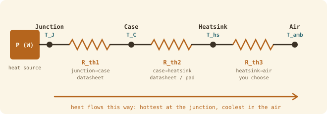

## The idea
Every watt a component loses becomes heat inside its silicon **junction**. That heat has to flow out through the **case**, into a **heatsink**, then into the **air**. Each step resists the flow, so the junction ends up hotter than the air. Treat it exactly like Ohm's law: **heat flow behaves like current, temperature like voltage, and thermal resistance like resistance**.

| Electrical | Thermal |
|---|---|
| Current $I$ (A) | Heat flow $P$ (W) |
| Voltage difference (V) | Temperature difference $\Delta T$ (°C) |
| Resistance $R$ (Ω) | Thermal resistance $R_{th}$ (°C/W) |
| $V = IR$ | $\Delta T = P\,R_{th}$ |
| Series resistors add | $R_{th1} + R_{th2} + R_{th3}$ |

| Resistance | From | To | Where you get it |
|---|---|---|---|
| $R_{th1}$ ($R_{thJC}$) | junction | case | Datasheet |
| $R_{th2}$ ($R_{thCS}$) | case | heatsink | Datasheet (greased), more with an insulating pad |
| $R_{th3}$ | heatsink | air | **You choose it** by picking a heatsink |
| $R_{thJA}$ | junction | air, with no heatsink | Datasheet |

## Junction temperature
The same heat $P$ flows through every step, like current through series resistors. Start from the air, which you know, and climb:

$$T_{hs} = T_{amb} + P R_{th3} \;\rightarrow\; T_C = T_{hs} + P R_{th2} \;\rightarrow\; T_J = T_C + P R_{th1}$$

$$\boxed{T_J = T_{amb} + P\,(R_{th1} + R_{th2} + R_{th3})}$$

With no heatsink, use the single datasheet value instead: $T_J = T_{amb} + P\,R_{thJA}$.

**The limits:**
- Silicon's absolute maximum is **175 °C**. Design for 100–120 °C, and **never above 120 °C**.
- Safety margin: $\text{margin} = 100 - \dfrac{T_J}{175}\times100$, aiming for **at least 30%**. 120 °C gives 31.4%.

## Sizing a heatsink
Rearrange for the one resistance you choose:

$$\boxed{R_{th3} = \frac{T_J - T_{amb}}{P} - (R_{th1} + R_{th2})}$$

Put in your target $T_J$, and the answer is the **largest** $R_{th3}$ you can get away with. Pick a heatsink at or below it. **Lower °C/W means a bigger heatsink.**

> [!warning] A negative answer
> If $R_{th3}$ comes out negative, even a perfect heatsink ($R_{th3} = 0$) can't keep the part cool, because $R_{th1} + R_{th2}$ alone already make it too hot. The fixes:
> - a better interface (thermal grease, about 0.24 °C/W, instead of an insulating pad)
> - less loss: lower switching frequency, a part with lower $R_{DS(on)}$, or MOSFETs in parallel
> - a lower ambient temperature, or forced-air or liquid cooling

## Worked example
The IRFP140 from [[MOSFET power loss]] dissipates **5.36 W** in a robot whose electronics bay reaches **35 °C**. Datasheet: $R_{thJC} = 0.83$, $R_{thCS} = 0.24$ (greased), $R_{thJA} = 40$ °C/W.
1. Can it run without a heatsink?
2. What heatsink keeps $T_J$ at 100 °C?
3. You fit an 8 °C/W heatsink. What are $T_J$ and the margin?

> [!example]- Answer
> 1. $T_J = 35 + 5.36 \times 40 = 249$ °C. **No.** It's far over 175 °C.
> 2. $R_{th3} = \dfrac{100 - 35}{5.36} - (0.83 + 0.24) = 12.13 - 1.07 = 11.1$ °C/W. Any heatsink at or below 11 °C/W works.
> 3. $T_J = 35 + 5.36 \times (0.83 + 0.24 + 8) = 35 + 48.6 = 83.6$ °C. Margin $= 100 - \dfrac{83.6}{175}\times100 = 52\%$ ✓

## Common mistakes
- Adding the thermal resistances but forgetting to add $T_{amb}$ at the end.
- Reading "lower $R_{th3}$" as "smaller heatsink". It's the opposite.
- Mixing $R_{thJA}$ (no heatsink) with the three-step chain. Use one or the other.

## Check yourself
> [!question]- 1. 40 W, $R_{th1} = 0.7$, $R_{th2} = 2.0$ (insulating pad), 50 °C ambient, target 120 °C. What heatsink?
> $R_{th3} = 70/40 - 2.7 = 1.75 - 2.7 = -0.95$ °C/W. **Negative, so it's impossible.** Swap the pad for grease: $1.75 - 0.94 = 0.81$ °C/W, which is a big but possible heatsink.

> [!question]- 2. P = 10 W, $T_{amb}$ = 60 °C, $R_{th}$ = 0.5, 1, 2 °C/W. Find $T_{hs}$, $T_C$ and $T_J$.
> $T_{hs} = 60 + 20 = 80$ °C, $T_C = 80 + 10 = 90$ °C, $T_J = 90 + 5 = 95$ °C.
