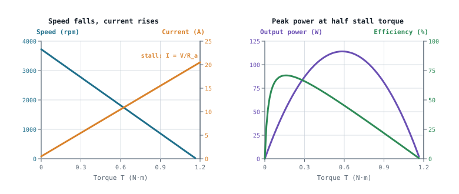
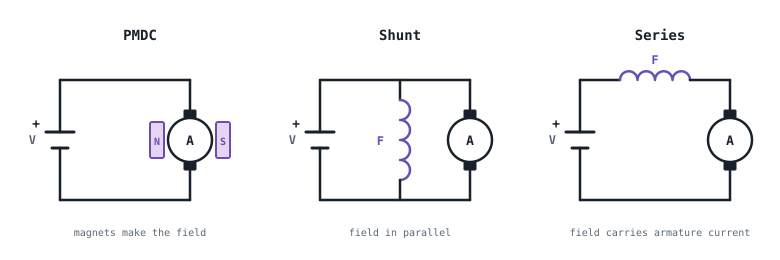

## The idea
Weeks 1–3 got electrical power from the battery or the grid to the motor's terminals. Week 4 is the motor itself: how it turns current into torque, the main types a robot might use, and where the energy is lost on the way.

## The motors used in robotics
| Motor | How it works | Strengths | Weaknesses |
|---|---|---|---|
| **Brushed DC** | A commutator and brushes switch the coil current as the rotor turns. Speed set by voltage (PWM) | Cheap, simple drive, easy speed control, good low-speed torque with a gearbox | Brushes wear and spark (electrical noise); needs maintenance |
| **Stepper** | The driver energises the stator phases in sequence; the rotor moves one fixed step per pulse | Positions without a sensor; strong holding torque | Can miss steps; torque falls with speed; draws current even at rest |
| **Brushless DC (BLDC)** | Magnets on the rotor; an inverter switches the stator coils in sequence (six-step) | Efficient, long-lived, high power density and speed | Needs an inverter and position sensing; harder at low speed |
| **PMSM** | Like BLDC but with smooth sinusoidal currents (field-oriented control) | Very smooth, precise torque | Complex controller, needs accurate position feedback |
| **Servo** | A **system**: motor + encoder + drive in a closed loop | Corrects its own position, speed or torque errors | Cost, tuning and set-up |

Steppers get their own page: [[Stepper motors]].

## How a brushed DC motor makes torque
- The **stator** (the stationary part) makes a magnetic field B, from permanent magnets or field windings.
- The **rotor** or **armature** carries coils. A conductor of length L carrying current I across a field B feels a force $F = BIL$, at right angles to both the wire and the field. Force × radius = torque.
- After half a turn, the same current would push the coil backwards. The **commutator and brushes reverse the coil current every half-turn**, so the torque always acts the same way. (A brushless motor does this switching electronically, with an inverter: see [[Motor drives]].)

**The generator effect happens at the same time.** A conductor moving through a field has a voltage induced in it, $e = BLv$. In a motor this **back-EMF** opposes the supply, and it's the key to how a DC motor regulates itself.

### Worked example: a single loop
A single rectangular coil of active length 0.06 m and diameter 0.05 m spins at 2000 rpm in a 0.4 T field, carrying 3 A. Find the peak EMF and the torque.

> [!example]- Answer
> $\omega = 2000 \times 2\pi/60 = 209.4$ rad/s · $r = 0.025$ m → $v = \omega r = 5.24$ m/s
> Each side: $e = BLv = 0.4 \times 0.06 \times 5.24 = 0.126$ V. Two sides in series: **$E_{max} = 0.251$ V**
> After commutation the average is $\tfrac{2}{\pi}E_{max} = 0.637 \times 0.251 = 0.160$ V (the same factor as a rectified sine; see [[AC values]])
> Force per side: $F = BIL = 0.4 \times 3 \times 0.06 = 0.072$ N
> Two sides at radius r: **$T = 2Fr = 2 \times 0.072 \times 0.025 = 0.0036$ N·m**
> Real motors have many coils and commutator segments, so the torque and EMF are much larger and smoother.

## The two equations that run everything
$$\boxed{V = I_aR_a + K_e\,\omega} \qquad \boxed{T = K_t\,I_a}$$

- **The electrical side:** the supply voltage is shared between the drop across the winding resistance and the back-EMF, which grows with speed.
- **The mechanical side:** torque is proportional to current.
- In SI units, $K_t = K_e$ (N·m/A = V·s/rad). See [[DC motor performance and selection]].

**What they mean in practice:**
- **Speed is set by voltage.** As the motor speeds up, the back-EMF rises until it nearly cancels the supply. That's the no-load speed, $\omega_0 \approx V/K_e$. This is why PWM (average voltage) controls speed.
- **Torque is set by current, and the motor adjusts itself.** Load it → it slows → back-EMF falls → more current flows ($I_a = (V - K_e\omega)/R_a$) → more torque. It settles where the motor's torque matches the load.
- **Stall is dangerous.** At $\omega = 0$ there's no back-EMF, so $I_{stall} = V/R_a$, often many times the rated current. Drivers, MOSFETs, wiring and fuses must be **sized for the stall current**, or the driver must limit current.

*Curves for a 24 V motor with $R_a = 1.2$ Ω and $K_t = K_e = 0.06$: no-load speed about 3800 rpm, stall current 20 A. Speed falls in a straight line as torque rises. Output power peaks at half the stall torque, but efficiency peaks much earlier, at light load. That's why motors are chosen to run well below stall, not at peak power.*

## DC motor types: how the field is made

| Type | Field | Behaviour | Watch out |
|---|---|---|---|
| **Permanent magnet (PMDC)** | Magnets | Straight-line speed–torque curve, compact, efficient (no field winding loss), simple PWM control | The field can't be adjusted; magnets can demagnetise with over-current or heat |
| **Shunt-wound** | Winding **in parallel** with the armature | Speed stays fairly steady as the load changes | If the field circuit fails, the motor **overspeeds** |
| **Series-wound** | Winding **in series**, so it carries the armature current | **Very high starting torque**, roughly ∝ I². Used for traction and lifting | Speed varies hugely with load and it **runs away with no load** |
| **Compound** | Both windings | A mix of starting torque and steady speed | Some connections can be unstable |

**Why a series motor runs away:** with no load, the current falls, so the field weakens. A weaker field needs more speed to make enough back-EMF to balance the supply, so the motor keeps speeding up. Lose the load on a winch or a robot and it can destroy itself.

**PMDC is the robotics default:** predictable speed (a fixed field), simple to drive with PWM and an [[Motor drives|H-bridge]], efficient, and compact. Small mobile robots, AGVs and educational platforms nearly all use geared PMDC motors.

## Construction
- **Iron-core:** windings on a laminated iron core. Robust and cheap, from about 1 W to kW, 50–85% efficient. More inertia and some "cogging" (lumpy torque at low speed). Mobile robots and geared actuators.
- **Coreless (ironless):** a self-supporting hollow winding. Very low inertia for fast, smooth response, 60–90% efficient, but expensive and limited by heat. Grippers, medical and precision robots.

## Losses and temperature
Not all the input power becomes shaft power:

$$P_{loss} = I^2R_a + V_{brush}\,I + P_{iron+mech}$$

The three parts are **copper loss** in the windings, **brush loss** from the voltage drop at the brushes, and **iron and mechanical loss** (magnetising the core, bearing friction and air drag).

$$\eta = \frac{P_{out}}{P_{in}} = \frac{T\omega}{VI} \qquad \Delta T = P_{loss}\,R_\theta \qquad T_{motor} = T_{amb} + \Delta T$$

It's the same thermal idea as a heatsink (see [[Thermal design and heatsinks]]), with the motor's own thermal resistance $R_\theta$.

| $T_{motor}$ | Meaning |
|---|---|
| 40–80 °C | Normal |
| 80–100 °C | Hot: check the manufacturer's limits |
| 100–130 °C | Concerning: check the insulation class |
| > 130 °C | Beyond typical insulation ratings |

Efficiency isn't one fixed number: it changes with load and speed (see the curves above).

### Worked example: losses and temperature
A motor on 24 V draws 2 A and delivers 0.12 N·m at 3000 rpm. $R_a = 1.5$ Ω, the brush drop is 0.8 V, $R_\theta = 6$ °C/W and the room is at 25 °C. Find the efficiency, the losses and the motor temperature. What's the stall current?

> [!example]- Answer
> $P_{in} = 24 \times 2 = 48$ W · $\omega = 3000 \times 2\pi/60 = 314.2$ rad/s · $P_{out} = 0.12 \times 314.2 = 37.7$ W
> **$\eta = 37.7/48 = 78.5\%$** · total loss $= 48 - 37.7 = 10.3$ W
> Copper $= 2^2 \times 1.5 = 6.0$ W · brushes $= 0.8 \times 2 = 1.6$ W · iron and mechanical (the rest) $= 2.7$ W
> $\Delta T = 10.3 \times 6 = 61.8$ °C → **$T_{motor} = 86.8$ °C**: hot, so check the rating
> **$I_{stall} = 24/1.5 = 16$ A**, eight times the running current. At stall all 384 W ($16^2 \times 1.5$) becomes heat.

## Common mistakes
- **Thinking torque rises with speed.** It's the other way round: more load means less speed and more current.
- **Sizing the driver for running current.** Size it for stall, or limit the current.
- **Mixing up shunt and series faults.** Shunt overspeeds if its *field fails*; series runs away if it *loses its load*.
- **Forgetting rpm → rad/s** before $P = T\omega$.

## Check yourself
> [!question]- 1. Why does a DC motor draw more current when it's loaded?
> The load slows it, so the back-EMF ($K_e\omega$) falls. More of the supply voltage is left across $R_a$, so more current flows, which gives the extra torque ($T = K_tI$).

> [!question]- 2. Why is a PMDC motor preferred over a series motor for a mobile robot?
> Its fixed field gives a predictable, straight-line speed–torque relationship that's easy to control, and it won't run away if the wheels lose contact or the load drops. A series motor's huge starting torque isn't worth that risk.

> [!question]- 3. A 12 V motor has $R_a = 0.5$ Ω. What's its stall current, and why does it matter?
> $12/0.5 = $ **24 A**. The driver, wiring and fuse must survive it, or the driver must limit current; otherwise a jammed wheel burns out the motor or the MOSFETs.

Next: using these equations to analyse and choose motors, in [[DC motor performance and selection]].
