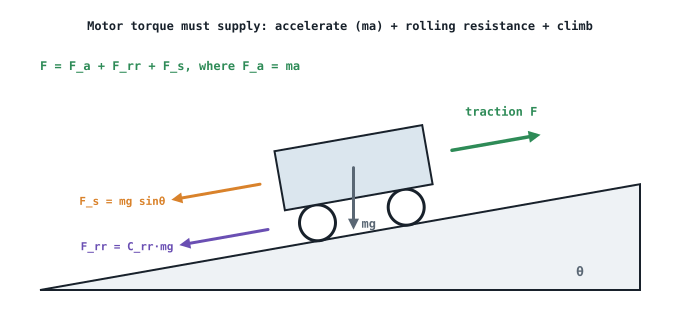

## The idea
[[DC motor performance and selection]] and [[Stepper motors]] start from a motor and ask what it can do. This page runs the other way: **start from the robot** (its mass, wheels, speed, acceleration and the slopes it must climb) and work out the **speed, torque and power the motor must provide**. It's the reverse problem, and it's how you'd choose a motor for a new design.

## The forces a drive must overcome

| Force | Formula | Why it's there |
|---|---|---|
| Acceleration | $F_a = ma$ | Speeding the robot up ([[Friction and Newton's second law]]) |
| Rolling resistance | $F_{rr} = C_{rr}\,mg$ | Tyres deforming on the floor; $C_{rr} \approx 0.01$–0.03 on hard floors |
| Slope | $F_s = mg\sin\theta$ | The component of weight pulling the robot back down |

The worst case is all three at once: **accelerating up the steepest slope**:

$$F_{total} = F_a + F_{rr} + F_s$$

This assumes a hard floor, equal load sharing between the driven wheels and no air drag (which is tiny at walking speeds).

## The method
1. **Speeds:** wheel speed $n_w = \dfrac{v}{2\pi r} \times 60$ (rpm), then motor speed $n_m = G\,n_w$.
2. **Forces:** $F_{total} = ma + C_{rr}mg + mg\sin\theta$.
3. **Torque at the wheels:** $T_{wheels} = F_{total}\,r$, shared between the driven wheels: $T_w = T_{wheels}/N_w$.
4. **Back through the gearbox** (it multiplies torque, but loses some): $T_m = \dfrac{T_w}{G\,\eta_g}$.
5. **Add a safety factor** (typically 1.5) for slopes, payload and wear: $T_{m,rated} = SF \times T_m$.
6. **Power:** $P_m = T_{m,rated}\,\omega_m$, with $\omega_m = 2\pi n_m/60$.

Then look for a motor whose **continuous** rated torque, speed and power all exceed these.

## Worked example
A 30 kg delivery robot has 0.08 m radius wheels and must reach 1.2 m/s, accelerate at 0.6 m/s² and climb an 8° ramp. $C_{rr} = 0.03$, two driven wheels, a 10:1 gearbox at 85% efficiency, and a safety factor of 1.5. What does each motor need?

> [!example]- Answer
> **1. Speeds:** $n_w = \dfrac{1.2}{2\pi \times 0.08} \times 60 = 143$ rpm → $n_m = 10 \times 143 = $ **1432 rpm**
> **2. Forces:** $F_a = 30 \times 0.6 = 18.0$ N · $F_{rr} = 0.03 \times 30 \times 9.81 = 8.8$ N · $F_s = 30 \times 9.81 \times \sin8° = 41.0$ N
> $F_{total} = 67.8$ N. The ramp is by far the biggest part.
> **3. Wheels:** $T_{wheels} = 67.8 \times 0.08 = 5.42$ N·m → $T_w = 2.71$ N·m per wheel
> **4. Motor:** $T_m = 2.71/(10 \times 0.85) = 0.319$ N·m
> **5. Rated:** $1.5 \times 0.319 = $ **0.48 N·m**
> **6. Power:** $\omega_m = 2\pi \times 1432/60 = 150$ rad/s → $P_m = 0.48 \times 150 = $ **72 W** per motor
> So you'd look for a motor of roughly 80–100 W continuous, about 0.5 N·m, at around 1500 rpm, with a 10:1 gearbox.

## What changes the answer most
| Change | Effect |
|---|---|
| Steeper slope | $F_s$ grows with $\sin\theta$; usually the biggest force by far |
| Heavier robot or payload | Every force scales with mass |
| Faster acceleration | Raises $F_a$, but only during speed-ups |
| Higher gear ratio | Less motor torque needed, but more motor speed |
| Bigger wheels | More torque needed for the same force, less speed needed |

## Common mistakes
- **Forgetting to share the torque between the driven wheels.**
- **Multiplying by the gear efficiency instead of dividing.** A lossy gearbox means the motor must supply *more* torque.
- **Degrees vs radians in $\sin\theta$** on the calculator.
- **Skipping the safety factor**, then choosing a motor that runs at 100% on the first ramp.

## Check yourself
> [!question]- 1. Without the 8° ramp, what would the rated motor torque be in the example above?
> $F = 18 + 8.8 = 26.8$ N → $T_w = 26.8 \times 0.08/2 = 1.07$ N·m → $T_m = 1.07/8.5 = 0.126$ N·m → rated **0.19 N·m**. The ramp more than doubles the requirement.

> [!question]- 2. Why include a safety factor if you've already used the worst-case slope and acceleration?
> To cover what the model ignores: heavier payloads, softer floors (higher $C_{rr}$), gearbox wear, temperature derating and battery voltage sag. It also keeps the motor's utilisation comfortably below 100%.

Back to [[WM1AD/index|WM1AD]], or practise in [[WM1AD practice questions]].
