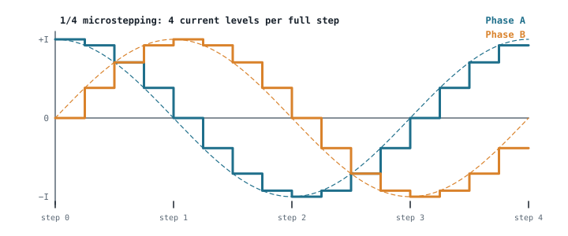

## The idea
A DC motor spins for as long as it's powered; to know *where* it is, you need an encoder. A stepper moves in **fixed, exact steps**: one electrical pulse, one step. **Count the pulses and you know the position**, with no sensor at all (open-loop control). That's why steppers drive 3D printers, CNC machines, pick-and-place heads and camera mounts: anywhere that **position matters more than speed**.

## How it moves
1. The driver energises a pattern of stator coils, which makes a magnetic field.
2. The rotor (magnets or a toothed iron core) is pulled into line with it, to the position of **minimum reluctance**, where the magnetic path is easiest.
3. The next pattern moves the field on, and the rotor follows one step.

So:
- **Position** = the number of pulses sent
- **Speed** = the pulse frequency
- **Direction** = the order of the pattern

The **driver is essential**. A stepper can't run from a plain DC supply.

## Types
| Type | Rotor | Notes |
|---|---|---|
| Permanent magnet (PM) | Magnetised | Coarse steps, cheap |
| Variable reluctance (VR) | Toothed soft iron, no magnet | No holding torque when unpowered |
| **Hybrid** | Toothed **and** magnetised | Fine steps and good torque. **The robotics standard: 1.8°, 200 steps per revolution** |

$$\text{Step angle} = \frac{360°}{\text{rotor teeth} \times \text{phases}} \qquad N_{steps} = \frac{360°}{\text{step angle}}$$

| Step angle | Steps per rev | |
|---|---|---|
| 0.9° | 400 | Fine robotics positioning |
| 1.8° | 200 | The common choice (NEMA 17 motors) |
| 3.6° | 100 | |
| 7.5° or 15° | 48 or 24 | Usable, but coarse |

## Microstepping
The driver can split each full step into M smaller ones by **varying the two phase currents in small increments**, following a sine and a cosine, instead of just switching them on and off.

$$N_{\mu steps} = N_{steps}\,M \qquad \theta_\mu = \frac{\text{step angle}}{M}$$

| Mode (1.8° motor) | Angle per microstep | Per revolution |
|---|---|---|
| Full step | 1.8° | 200 |
| 1/2 | 0.9° | 400 |
| 1/8 | 0.225° | 1600 |
| 1/16 | 0.1125° | 3200 |

- **Benefit:** much **smoother**, quieter motion, with less vibration and resonance.
- **Catch:** each microstep has **less torque**. Under load or friction, the rotor can lag behind or bunch up rather than land exactly on each tiny position. So finer microstepping is smoother, **not necessarily more accurate**.
- The step angle is a **mechanical** property of the motor; microstepping is a **control** method in the driver.

## Unipolar vs bipolar
| | Unipolar | Bipolar |
|---|---|---|
| Windings | Centre-tapped; only half of each coil works at a time | The whole coil is used |
| Drive | Four low-side switches; current never reverses (simple) | **One H-bridge per phase**, so two for a two-phase motor (current both ways) |
| Torque | Lower | **Higher**: more copper carrying current |
| Use | Simple, educational | Robots, CNC, 3D printers |

Driver chips put both H-bridges on one chip and use **current chopping**: they sense each coil's current and switch off the moment it reaches the rated value. See [[Motor drives]].

## Strengths and weaknesses
| Strengths | Weaknesses |
|---|---|
| Accurate positioning **with no sensor** | **Missed steps**: if the load exceeds the available torque it skips, and with no feedback **it doesn't know** |
| High **holding torque** at standstill | **Torque falls** as speed rises |
| Simple digital control (step and direction pins) | **Resonance** at some speeds: noise and vibration |
| Repeatable, brushless (no wear) | Draws current **even when holding still**: heat and wasted energy |

**A 3D printer shows all of these.** At power-on it has no idea where the axes are, so it drives each one into an **endstop** and calls that zero (homing). After that, position is just counted pulses. If the nozzle catches on the print, a motor **misses steps**, the printer carries on regardless, and every later layer is shifted. That's a *layer shift*, the classic open-loop failure. Fixes are a torque margin, gentler acceleration, or an encoder (a "closed-loop stepper").

## The forward problem: is this motor suitable?
**Given** the motor (step angle, current and resistance per phase, inductance, holding torque $T_h$, microstepping M, gearbox G, load torque, motor speed $S_m$ in rpm), **calculate** its performance and check it against the requirements:

$$f_{step} = \frac{N_{steps}\,S_m}{60} \qquad f_{\mu step} = f_{step}\,M \qquad n_{out} = \frac{S_m}{G} \qquad \theta_{out} = \frac{\theta_\mu}{G}$$

$$P_{phase} = RI^2\ (\times2 \text{ for both phases}) \qquad \tau_e = \frac{L}{R} \qquad T_{out} = T_hG \qquad SF = \frac{T_h}{T_{load}}$$

$$\omega_m = \frac{2\pi S_m}{60} \qquad P = T_h\,\omega_m \qquad \omega_{out} = \frac{2\pi\,n_{out}}{60}$$

### Worked example
A 1.8° hybrid stepper: 2.5 A per phase, 0.9 Ω, 3 mH, $T_h = 0.55$ N·m, 1/16 microstepping, 5:1 gearbox, 0.4 N·m load, running at 150 rpm. The joint needs $T_{out} \ge 2.5$ N·m, $\omega_{out} \ge 3$ rad/s and $P \ge 8$ W. Is it suitable?

> [!example]- Answer
> **Resolution:** 200 steps → 3200 microsteps per rev · $\theta_\mu = 1.8/16 = 0.1125°$ · after the gearbox $\theta_{out} = 0.0225°$
> **Pulse rates:** $f_{step} = 200 \times 150/60 = 500$ Hz · $f_{\mu step} = 500 \times 16 = 8$ kHz
> **Output:** $n_{out} = 150/5 = 30$ rpm · $T_{out} = 0.55 \times 5 = $ **2.75 N·m ✓**
> **Margins:** $SF = 0.55/0.4 = 1.38$
> **Electrical:** $P_{phase} = 0.9 \times 2.5^2 = 5.63$ W (11.25 W with both phases on) · $\tau_e = 3\text{ mH}/0.9 = 3.3$ ms
> **Power:** $\omega_m = 2\pi \times 150/60 = 15.7$ rad/s → $P = 0.55 \times 15.7 = $ **8.64 W ✓**
> **Speed:** $\omega_{out} = 2\pi \times 30/60 = $ **3.14 rad/s ✓**
> **All three requirements pass**, but with thin margins (the safety factor is only 1.38, and the power only 8% above the target).

### Worked example: a belt conveyor
A 1.8° stepper drives a conveyor belt directly through a pulley of 10 mm radius, with 1/16 microstepping. The belt must run at 50 mm/s. Find the belt movement per microstep, the motor speed and the pulse frequency the microcontroller must produce.

> [!example]- Answer
> Belt per revolution $= 2\pi \times 10 = 62.8$ mm · microsteps per revolution $= 3200$
> **Per microstep:** $62.8/3200 = 0.0196$ mm (about 20 µm)
> **Motor speed:** $50/62.8 = 0.796$ rev/s = **47.7 rpm**
> **Pulse rate:** $f_{step} = 200 \times 47.7/60 = 159$ Hz → $f_{\mu step} = 159 \times 16 = $ **2.55 kHz**
> Quick check: $50 \text{ mm/s} \div 0.0196 \text{ mm/pulse} = 2550$ pulses/s ✓
> In full-step mode (M = 1) it would be 159 Hz and 0.31 mm jumps: visibly jerky, and in the range where steppers tend to resonate.

## Common mistakes
- **Treating microstepping as extra accuracy.** It's mainly smoothness.
- **Forgetting the gearbox in both directions:** output speed ÷ G, output torque × G.
- **Using rpm in $P = T\omega$.** Convert to rad/s.
- **Bipolar = one H-bridge.** It's one **per phase**: two for a two-phase motor.

## Check yourself
> [!question]- 1. Why can a stepper position accurately without a sensor, and what's the risk?
> Each pulse is a known, fixed angle, so counting pulses gives the position after homing to a reference. The risk is missed steps under overload: with no feedback, the error goes unnoticed and carries into every later position.

> [!question]- 2. A 0.9° motor with 1/8 microstepping turns a 5 mm-pitch lead screw. How far does the nut move per microstep?
> 400 × 8 = 3200 microsteps per revolution, so $5/3200 = $ **0.0016 mm (1.6 µm)**.

> [!question]- 3. Why do robots use bipolar rather than unipolar steppers?
> Bipolar drives use the whole winding, giving more torque from the same size motor. The extra drive complexity (two H-bridges) costs almost nothing now that driver chips contain both.

Next: working out what torque a mobile robot actually needs, in [[Sizing a drive motor]].
