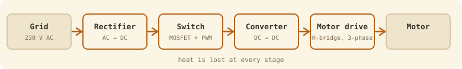

Electrical principles, power electronics and motors: how energy gets from a battery or the grid into a robot's motors, and how to choose the parts.

## Week 3: from the wall socket to the motor
This week follows one chain. Each link has its own guide.

1. [[AC values]]: peak, RMS and average, and why parts must survive 325 V
2. [[Bridge rectifiers]]: four diodes that make AC one-way, smoothing, ripple and heat
3. [[Power switches]]: relay, SSR, BJT, MOSFET and IGBT, and how to choose
4. [[PWM]]: controlling power by switching fast
5. [[MOSFET power loss]]: conduction and switching losses from a datasheet
6. [[Thermal design and heatsinks]]: the thermal resistance ladder and sizing a heatsink
7. [[DC-DC converters]]: buck and boost, derived from volt-second balance
8. [[Motor drives]]: H-bridges, three-phase inverters and stepper drivers
9. [[Week 3 formula sheet]]: everything on one page

> [!tip] Interactive version
> There's a [one-page interactive version](/static/wm1ad-week3.html) with an animated bridge, a PWM slider and calculators for every formula.

## Coming later
Weeks 1–2 (circuit laws, mesh analysis, RC transients) and later weeks (motors, batteries, motor selection).
